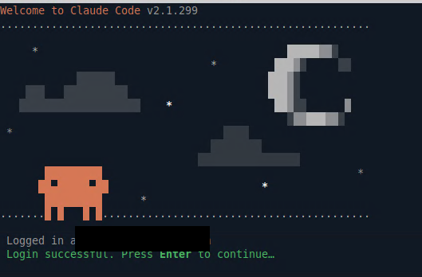

# Historia czatu — dzień 1, 23 listopada 2026

Wiadomości publiczne w kolejności chronologicznej. Reakcje oznaczają zliczenia przy wiadomościach, nie rozłączne głosy ani liczbę uczestników.

## Wiadomości

- **09:40 — M.A.:** Poproszę ponownie o przesłanie pdf z dostępami

- **10:01 — Łukasz Matuszewski:** 

- **10:02 — Łukasz Matuszewski:** https://code.claude.com/docs/en/security

- **10:10 — Łukasz Matuszewski:** https://devpowers.com/szkolenia/jsystems/ai-programming-2026-11/  
  Materiały szkoleniowe

- **10:16 — Łukasz Matuszewski:** Repozytorium szkoleniowe:  
  https://github.com/LucasMatuszewski/jsystems-ai-programming-2026-11

- **10:22 — Łukasz Matuszewski:** Osoby które warto śledzieć:  
  https://github.com/LucasMatuszewski/jsystems-ai-programming-2026-11/blob/main/course-materials/Course%20INDEX%20-%20AI%20in%20Programming.md#people-and-accounts-to-follow-in-ai

- **10:24 — P.T.:** zacina się głos czasami

- **10:35 — Łukasz Matuszewski:** Lokalny model AI z USA:  
  https://huggingface.co/thinkingmachines/Inkling-2-Mini

- **10:37 — Łukasz Matuszewski:** https://x.com/miramurati  
  CEO Thinking Machines, ex CTO OpenAI  
  Twórczyni Inkling

- **10:39 — Łukasz Matuszewski:** Pierwszy autocomplete:  
  https://docs.tabnine.com/main

- **10:41 — Łukasz Matuszewski:** https://crewai.com/  
  Jeden z pierwszy frameeworkfów do zespołów agentów AI

- **11:03 — Łukasz Matuszewski:** Koniec przerwy 11:20

- **11:03 — M.M.:** ok

- **11:21 — E.:** jestem

- **11:21 — M.Ś.:** jestem

- **11:21 — M.M.:** jestem

- **11:21 — B.B.:** jestem

- **11:22 — R.K.:** jestem

- **11:28 — Łukasz Matuszewski:** https://omarchy.org/  
  2 osoby na pół etatu stworzyły nowe distro Linux pod agentów

- **11:37 — Łukasz Matuszewski:** IDE agentowe  
  https://cursor.com/

- **11:40 — Łukasz Matuszewski:** https://x.com/karpathy  
  Andrej Karpathy, Ojciec/wujek AI ;P

- **11:41 — Łukasz Matuszewski:** Definicja Vibe Coding:  
  https://x.com/karpathy/status/1886192184808149383?lang=en

- **11:45 — Łukasz Matuszewski:** Vibe Engineering

- **11:48 — Łukasz Matuszewski:** AI Slop  
  coś co od razu wygląda na AI Generated

- **12:21 — E.D.:** TIBCO

- **12:21 — E.D.:** Camel

- **12:30 — Łukasz Matuszewski:** Walki modeli / Agentów  
  https://arena.ai/

- **12:38 — Łukasz Matuszewski:** Dowolna aplikacja / gra, np z dzieciństwa, albo o ulubionej postaci, w świecie który Was interestuje itp.  
  Czas do 12:42

- **12:38 — Łukasz Matuszewski:** Vibe Coding = opiszcie tylko pomysł CO ma postać, NIE JAK powstać

- **13:04 — Łukasz Matuszewski:** Status page - stabilność, uptime:  
  https://status.openai.com/

- **13:05 — Łukasz Matuszewski:** https://status.claude.com/

- **13:06 — M.M.:** ok

- **13:07 — Łukasz Matuszewski:** Koniec przerwy 13:35

- **13:36 — M.Ś.:** jestem

- **13:36 — M.M.:** jestem

- **13:37 — Łukasz Matuszewski:** Agent Leaderboard - którzy agenci najlepsi jako Manager / Orchestrator:  
  https://arena.ai/leaderboard/agent

- **13:48 — Łukasz Matuszewski:** Ranking programistów:  
  https://arena.ai/leaderboard/code/webdev

- **13:53 — Łukasz Matuszewski:** Ranking do zadań biurowych:  
  https://arena.ai/leaderboard/agent/work

- **13:53 — Łukasz Matuszewski:** Agregator Benchmarków:  
  https://artificialanalysis.ai/

- **13:54 — Łukasz Matuszewski:** Index inteligencji:  
  https://artificialanalysis.ai/#intelligence

- **13:59 — Łukasz Matuszewski:** https://www.bielik.ai/  
  Polski model LLM

- **14:05 — Łukasz Matuszewski:** Ciekawe tanie chińskie alternatywy:  
  https://artificialanalysis.ai/models/mimo-v2-6-pro  
  https://artificialanalysis.ai/models/kimi-k3-1-pro  
  https://artificialanalysis.ai/models/glm-5-3  
  https://artificialanalysis.ai/models/qwen4-max

- **14:06 — Łukasz Matuszewski:** Amerykański jedyny dobry open weight w tej chwili:  
  https://artificialanalysis.ai/models/inkling-2-small

- **14:07 — Łukasz Matuszewski:** Ranking Open Weight modeli do programowania:  
  https://arena.ai/leaderboard/code/webdev?license=open-source

- **14:12 — Łukasz Matuszewski:** Najlepsze modele do Self Hostingu:  
  wymagają około 32GB VRAM lub współdzielonego RAM np. w Mac Mini / Ultra  
  Chiński Qwen  
  https://arena.ai/leaderboard/code/webdev/models/qwen3.8-27b-ebux  
  US Inkling  
  https://arena.ai/leaderboard/code/webdev/models/inkling-2-mini-ez3a

- **14:13 — Łukasz Matuszewski:** Poziomy myślenia vs jakość i cena:  
  https://artificialanalysis.ai/#intelligence-efficiency-tabs

- **14:15 — Łukasz Matuszewski:** https://huggingface.co/thinkingmachines/Inkling-2-Mini

- **14:23 — Łukasz Matuszewski:** git clone https://github.com/LucasMatuszewski/jsystems-ai-programming-2026-11.git

- **14:23 — Łukasz Matuszewski:** https://devpowers.com/szkolenia/jsystems/ai-programming-2026-11/Prezentacja_01_Start_kursu.html#9

- **14:24 — Łukasz Matuszewski:** git clone https://github.com/LucasMatuszewski/jsystems-ai-programming-2026-11.git cd jsystems-ai-programming-2026-11 git switch -c feat/moja-aplikacja claude

- **14:26 — Łukasz Matuszewski:** GH Copilot CLI:  
  https://github.com/github/copilot-cli

- **14:27 — Łukasz Matuszewski:** ! = shell mode

- **14:27 — Łukasz Matuszewski:** ! git clone https://github.com/LucasMatuszewski/jsystems-ai-programming-2026-11.git

- **14:38 — M.Ś.:** nie

- **14:39 — Łukasz Matuszewski:** /cd <path> = dobra wyszukiwarka

- **14:40 — Łukasz Matuszewski:** ! cd <path> = alternatywa dla shell mode

- **14:41 — Łukasz Matuszewski:** ctrl+c = zamknąć Claude

- **14:41 — Łukasz Matuszewski:** Moja wersja przed restartem: v2.1.299

- **14:41 — Łukasz Matuszewski:** claude --continue

- **14:42 — Łukasz Matuszewski:** Moja wersja po restarcie: v2.1.330

- **14:42 — Łukasz Matuszewski:** claude update

- **14:43 — M.Ś.:** działa

- **14:46 — Łukasz Matuszewski:** Folder roboczy na górze powinnien być:  
  ~/jsystems-ai-programming-2026-11

- **14:47 — Łukasz Matuszewski:** cwd:               /home/labuser/jsystems-ai-programming-2026-11

- **14:55 — Łukasz Matuszewski:** esc wyjście z widoków

- **15:06 — Łukasz Matuszewski:** /rc = remote controll  
  Praca na lokalnej sesji ze zdalnych urządzeń / Web / Mobile / desktop app  
  https://claude.ai/code

- **15:12 — P.T.:** 5min  
  *Reakcje: 👍: 1.*

- **15:12 — W.K.:** 5 minut

- **15:12 — Łukasz Matuszewski:** 15:20 Koniec przerwy

- **15:33 — Łukasz Matuszewski:** Pomysł na automatyzację co rano aby uruchomić limit 5h około 6:00am:  
  Research the news in the AI world, LLM models, and GPU graphics cards, and tell me a joke that covers these events in a humorous, slightly cheeky, ironic, and sarcastic way. Send me these news stories every morning to improve my humor.

- **15:36 — Łukasz Matuszewski:** Index ważnych rzeczy, linków, definicji, dokumentacji, narzędzi, badań itp.  
  https://github.com/LucasMatuszewski/jsystems-ai-programming-2026-11/blob/main/course-materials/Course%20INDEX%20-%20AI%20in%20Programming.md

- **15:37 — Łukasz Matuszewski:** Artykuł - badania dla Polskiego jako najlepszego języka dla LLM:  
  https://cryps.pl/sztuczna-inteligencja-mowi-po-polsku-nasz-jezyk-zdeklasowal-angielski-w-najnowszym-rankingu/

- **15:41 — Łukasz Matuszewski:** https://platform.openai.com/tokenizer  
  Tokenizer OpenAI

- **15:45 — Łukasz Matuszewski:** Duże modele językowe OpenAI przetwarzają tekst za pomocą tokenów, czyli powszechnych sekwencji znaków występujących w zbiorze tekstu. Modele uczą się rozumieć zależności statystyczne między tymi tokenami i doskonale radzą sobie z generowaniem kolejnego tokena w sekwencji tokenów.

- **15:45 — Łukasz Matuszewski:** Duże modele językowe OpenAI przetwarzają tekst za pomocą tokenów, czyli powszechnych sekwencji znaków występujących w zbiorze tekstu. Modele uczą się rozumieć zależności statystyczne między tymi tokenami i doskonale radzą sobie z generowaniem kolejnego tokena w sekwencji tokenów.

- **15:54 — Łukasz Matuszewski:** Handy - bezpłatny open source do dyktowania komend i dowolnego tekstu  
  https://handy.computer/

- **15:56 — Łukasz Matuszewski:** Canary 1B v2  
  Najlepszy model STT dla Polskiego i EN z polskim akcentem

- **15:59 — Łukasz Matuszewski:** Przykładowe prompty dla Handy w Post Porcessing:  
  https://github.com/LucasMatuszewski/jsystems-ai-programming-2026-11/blob/main/course-materials/Prompt%20examples/Handy.computer%20-%20transcription%20prompts.md

- **15:59 — Łukasz Matuszewski:** https://github.com/cjpais/Handy

- **16:21 — Łukasz Matuszewski:** TODO na jutro:  
  Sprawdzić czy Schedule zadziałał około 6 rano i czy okno sesji 5h jest już w trakcie / uruchomione  
  Podzielić się wynikami aplikacji / gry z Arena.ai  
  Ustawić Statusline - mój custom skupt, lub dowolna customizacja z komendą /statusline  
  Omówić trendy na rynku pracy i zmiany w kompetencjach i sposobie pracy. Case Studies.  
  Zainstalować Skills, pierwsze CLI (Playwright), a potem design systems, Opcjonalnie: Playwright extension + Chrome DevTools CLI Debug Mode  
  Dodać MCP/CLI Context7 i omówić connectors w Claude Web / Cloud i lokalne MCP vs CLI  
  Omówić instrukcje AGENTS.md / CLAUDE.md i workflow oraz /init (i dlaczego go nie używam)  
  Dodać personalizacje na poziomie urzytkownika (lokalnie) i chat (w chmurze) oraz na poziomie projektów (w repo)  
  Rozpocząć pracę nad PRD, ADR i może też Planem aplikacji (na ile zdążymy)  
  Jeśli zdążymy jutro: porównać Claude z Codex, Copilot CLI i extensions
