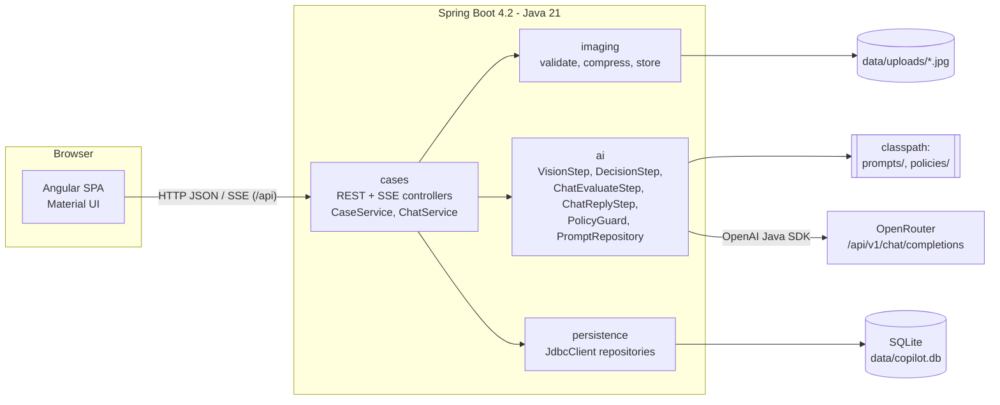
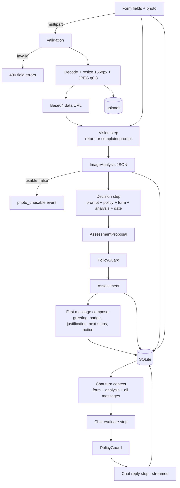
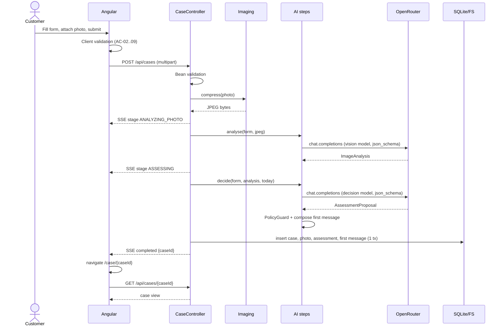
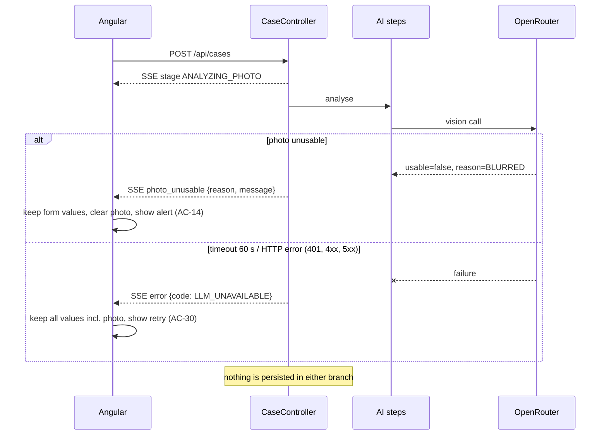
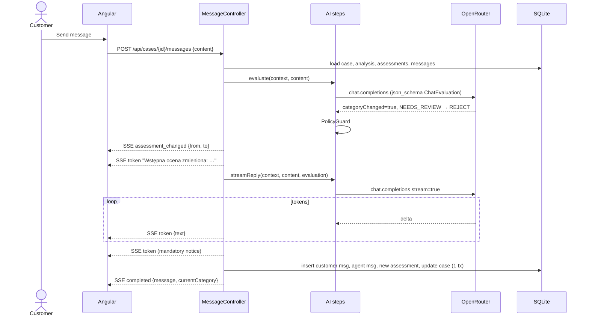
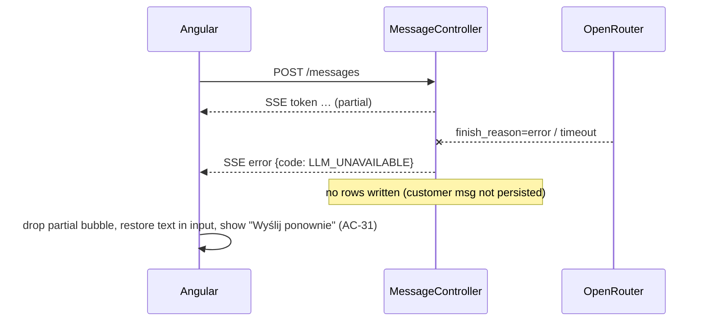
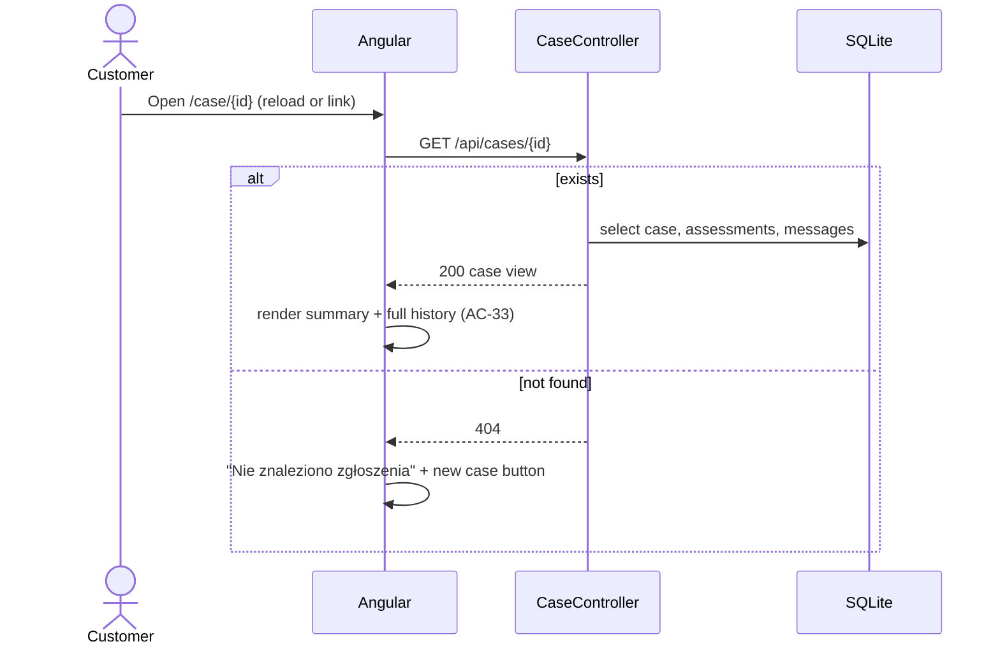

# ADR: Hardware Service Decision Copilot — Main Architecture

**Date:** 2026-11-25
**Status:** Accepted
**PRD:** [`docs/PRD.md`](../PRD.md)

---

## 1. Overview

The Hardware Service Decision Copilot PoC is a self-service web application. A customer submits a complaint or return with one photo, receives a preliminary assessment (Accept / Reject / Needs review) produced by two LLM steps (image analysis, then decision), and continues in a streamed chat with the decision agent. The functional scope, acceptance criteria (AC-01 … AC-37) and agent rules are defined in the PRD; this ADR set defines how to build them.

ADR files:

| File | Area |
|---|---|
| `000-main-architecture.md` | System, stack, repository layout, cross-cutting decisions, project initialization, contracts overview |
| [`001-backend-api.md`](001-backend-api.md) | Spring Boot REST + SSE API, validation, image processing, orchestration |
| [`002-ai-llm-integration.md`](002-ai-llm-integration.md) | OpenAI Java SDK against OpenRouter, Chat Completions vs Responses, prompts, policies, guardrails |
| [`003-persistence-and-storage.md`](003-persistence-and-storage.md) | SQLite schema, photo storage, transactions |
| [`004-frontend.md`](004-frontend.md) | Angular + Angular Material SPA, theming, form, chat, SSE client |

Terminology: the PRD's **session** is called a **case** in code and API. One submission = one case = one unique link.

---

## 2. Technology Documentation References

Versions verified on 2026-11-25 (Maven Central metadata, npm registry, Context7). Pin these versions at initialization.

| Library | Context7 ID or official docs | Version | Used for |
|---|---|---|---|
| Spring Boot | `/spring-projects/spring-boot`, `/websites/spring_io_spring-boot` | 4.2.0 | Backend framework (Spring MVC, validation, JDBC) |
| OpenAI Java SDK | `/openai/openai-java` | 4.113.0 (`com.openai:openai-java`) | LLM calls to OpenRouter (Chat Completions) |
| OpenRouter API | https://openrouter.ai/docs/api/reference/overview, https://openrouter.ai/docs/api/reference/streaming, https://openrouter.ai/docs/api/reference/responses/overview | — | LLM gateway |
| sqlite-jdbc (xerial) | https://github.com/xerial/sqlite-jdbc | 3.54.1.0 (`org.xerial:sqlite-jdbc`) | SQLite JDBC driver |
| TwelveMonkeys ImageIO WebP | `/haraldk/twelvemonkeys` | 3.15.3 (`com.twelvemonkeys.imageio:imageio-webp`) | Decode WEBP uploads (JDK ImageIO cannot) |
| Thumbnailator | https://github.com/coobird/thumbnailator | 0.4.21 (`net.coobird:thumbnailator`) | Resize + JPEG re-encode |
| WireMock | `/wiremock/wiremock.org` | 3.13.2 (`org.wiremock:wiremock-standalone`) | Stub OpenRouter in integration tests |
| Angular / Angular CLI | `/websites/angular_dev`, `/angular/angular-cli` | 22.3.0 | Frontend framework, Vitest unit test builder |
| Angular Material / CDK | `/angular/components`, `/angular/material2-docs-content` | 22.3.0 | UI components, theming, test harnesses |
| ngx-markdown | `/jfcere/ngx-markdown` | 22.1.1 (+ `marked` ^17 or ^18) | Render agent markdown, sanitized |
| Material date-fns adapter | https://material.angular.dev/components/datepicker/overview | 22.3.0 (`@angular/material-date-fns-adapter`) + `date-fns` | Polish date parsing/format |
| Vitest | `/vitest-dev/vitest` | via Angular CLI | Frontend unit tests |
| Playwright | https://playwright.dev/docs/intro | 1.65.1 (`@playwright/test`) | E2E tests and Manual QA |
| frontend-maven-plugin | https://github.com/eirslett/frontend-maven-plugin | 2.0.2 | Optional single-JAR packaging profile |

---

## 3. System Architecture

### Architecture pattern
Single-page application (Angular) + one backend service (Spring Boot monolith, layered) + embedded SQLite file + local photo directory. The backend is the only component that talks to OpenRouter; the API key never reaches the browser. Two runtime processes in development (Angular dev server, Spring Boot), one optional fat JAR for packaging.

### Repository structure

```
app/
  backend/                       Spring Boot, Maven wrapper (./mvnw), Java 21
    src/main/java/.../copilot/
      cases/                     REST + SSE controllers, DTOs, case orchestration
      imaging/                   upload validation, compression, photo storage
      ai/                        OpenRouter client, prompts, LLM steps, guardrails
      persistence/               JdbcClient repositories
      config/                    properties, beans, SPA forwarding, error handling
    src/main/resources/
      application.yml
      schema.sql
      prompts/                   system prompts (markdown, English instructions, Polish output)
      policies/                  return-policy.pl.md, complaint-policy.pl.md
    src/test/java/...            unit + integration tests
    src/test/resources/openrouter-captures/   verbatim captured OpenRouter responses
  frontend/                      Angular 22 workspace (npm)
    src/app/
      core/                      api services, SSE client, models
      features/case-form/
      features/case-chat/
      shared/                    badge, markdown wrapper, file drop zone
    src/styles/                  tokens.scss (brand), material-theme.scss
    proxy.conf.json
  e2e/                           Playwright project (real stack)
  package.json                   root scripts: dev (runs both), e2e
  AGENTS.md                      stack-specific agent rules (created during scaffolding)
data/                            runtime, gitignored: copilot.db, uploads/
```

Rules:
- `app/backend` and `app/frontend` are independent builds; the frontend depends on the backend only through the HTTP contract in Section 6.
- `data/` is created at startup if missing and is listed in `.gitignore`.
- A scoped `app/AGENTS.md` (or `app/backend/AGENTS.md` and `app/frontend/AGENTS.md`) holds stack commands and pinned versions; the root `AGENTS.md` stays generic.

### Technology stack

| Layer | Technology | Reason |
|---|---|---|
| Backend | Java 21 LTS, Spring Boot 4.2.0 (Spring MVC), Maven wrapper | User decision; Boot 4.2 supports Java 17–26; MVC + virtual threads fit the blocking SDK stream |
| LLM client | OpenAI Java SDK 4.113.0, Chat Completions API | Official SDK, custom base URL, streaming, vision, structured outputs; see 002 for API choice |
| LLM gateway / model | OpenRouter, `openai/gpt-6-luna` for both steps (configurable separately) | Model verified: text+image input, `structured_outputs`, `reasoning`, `tools` on all endpoints |
| Database | SQLite via `sqlite-jdbc` + Spring `JdbcClient` | Zero infrastructure for a PoC; JPA dialect for SQLite is community-only (8.0.0.CR2) |
| Photo storage | Local filesystem `data/uploads/` | Simple; DB keeps only the relative path |
| Image processing | ImageIO + TwelveMonkeys WebP reader + Thumbnailator | JDK 21 ImageIO has no WebP reader |
| Frontend | Angular 22.3.0 (standalone, zoneless, signals), Angular Material 22.3.0 | User decision |
| Markdown | ngx-markdown 22.1.1 | Angular 22 compatible, sanitized by default |
| Streaming transport | Server-Sent Events over POST, consumed with `fetch` + `ReadableStream` | `EventSource` is GET-only; `@microsoft/fetch-event-source` unmaintained since 2021 |
| Tests | JUnit 5, Mockito, Spring Boot Test, WireMock 3.13.2; Vitest + Material harnesses; Playwright 1.65.1 | Matches AGENTS.md test strategy |

---

## 4. Module Structure & Dependencies

| Module | Responsibility | Depends on | Used by |
|---|---|---|---|
| `frontend` | Form, chat, SSE parsing, theming | Backend HTTP API | Customer browser |
| `cases` (backend) | HTTP endpoints, request validation, SSE emission, orchestration of a submission and a chat turn | `imaging`, `ai`, `persistence` | `frontend` |
| `imaging` | Validate file type/size by content, decode, resize, JPEG encode, store/read photo files | filesystem | `cases` |
| `ai` | OpenRouter client bean, prompt loading, policy loading, vision step, decision step, chat-evaluate step, chat-reply streaming, guardrails | OpenAI Java SDK, `prompts/`, `policies/` | `cases` |
| `persistence` | Cases, assessments, messages repositories | SQLite | `cases` |
| `config` | Typed properties, error mapping, SPA forwarding, startup checks | all of the above (wiring only) | — |

Dependency direction: `cases → imaging | ai | persistence`. `ai`, `imaging` and `persistence` never depend on `cases` or on each other; `ai` receives plain domain records (form data, analysis, history) and returns domain records. No circular dependencies.

---

## 5. Data Models

Full schema in [003](003-persistence-and-storage.md). Conceptual entities:

- **Case**: `id` (UUID v4 string, also the link), `caseType` (COMPLAINT | RETURN), `deviceCategory` (enum of 13 PRD categories), `modelName`, `purchaseDate` (date), `description` (nullable for RETURN), `photoPath` (relative), `imageAnalysis` (JSON, see 002), `currentCategory` (ACCEPT | REJECT | NEEDS_REVIEW), `createdAt`. Persisted forever (no retention in PoC, PRD §12).
- **Assessment**: `id`, `caseId`, `category`, `previousCategory` (null for the first), `source` (INITIAL | CHAT_REVISION), `justification` (list of points, each with a policy rule reference), `nextSteps` (list), `createdAt`. A case has 1..n assessments; the latest equals `currentCategory`.
- **Message**: `id`, `caseId`, `role` (AGENT | CUSTOMER), `content` (markdown for AGENT, plain text for CUSTOMER), `assessmentId` (set when the message announced an assessment), `createdAt`. Ordered by `createdAt`, then `id`.

Domain value objects (not persisted separately): **CaseForm**, **ImageAnalysis**, **AssessmentProposal** (LLM output before guardrails), **ChatEvaluation**.

---

## 6. API / Interface Contracts

Base path `/api`. JSON uses camelCase; enums are UPPER_SNAKE strings; dates ISO-8601. Detailed contracts and error codes in [001](001-backend-api.md).

| Endpoint | Input | Output | Errors |
|---|---|---|---|
| `POST /api/cases` | multipart: `caseType`, `deviceCategory`, `modelName`, `purchaseDate`, `description?`, `photo` | `text/event-stream`: `stage`, then one of `completed {caseId}` / `photo_unusable {reason, message}` / `error {code, message}` | 400 JSON field errors (before stream), 413 file too large, 415 unsupported image |
| `GET /api/cases/{id}` | path id | JSON case view: form data, `photoUrl`, `currentCategory`, assessments, messages | 404 |
| `GET /api/cases/{id}/photo` | path id | `image/jpeg` | 404 |
| `POST /api/cases/{id}/messages` | JSON `{content}` 1–2000 chars | `text/event-stream`: optional `assessment_changed`, `token`*, then `completed {message, currentCategory}` or `error` | 400, 404, 409 reply already in progress |
| `GET /api/health` | — | Actuator health | — |

No authentication (PRD Out of Scope). Case ids are UUID v4, so links are unguessable.

---

## 7. Environment Variables

Loaded from the process environment; developers copy `.env.example` to `.env` and the root `dev` script exports it. `.env.example` is updated during scaffolding to contain every variable below.

| Variable | Purpose | Required | Example value |
|---|---|---|---|
| `OPENROUTER_API_KEY` | OpenRouter API key; backend fails fast at startup if empty | Yes | `sk-or-v1-...` |
| `OPENROUTER_BASE_URL` | OpenAI-compatible base URL | No | `https://openrouter.ai/api/v1` (default) |
| `LLM_MODEL` | Model for decision + chat steps | No | `openai/gpt-6-luna` (default) |
| `LLM_VISION_MODEL` | Model for image analysis | No | defaults to `LLM_MODEL` |
| `LLM_TIMEOUT_SECONDS` | Per-call timeout (PRD AC-30) | No | `60` |
| `OPENROUTER_APP_TITLE` | Optional attribution header `X-OpenRouter-Title` | No | `Hardware Service Decision Copilot` |
| `APP_DATA_DIR` | Directory for `copilot.db` and `uploads/` | No | `./data` |
| `SERVER_PORT` | Backend port | No | `8080` |

The SDK's own `OPENAI_API_KEY` / `OPENAI_BASE_URL` variables are **not** used; the client is built explicitly from the variables above so a stray `OPENAI_API_KEY` cannot be used silently.

---

## 8. Technical Decisions

### D1 — Spring Boot 4.2 + Spring MVC with virtual threads (not WebFlux)
**Status:** Accepted
**Date:** 2026-11-25
**Context:** The backend must stream LLM tokens to the browser while the OpenAI Java SDK exposes a blocking stream (`StreamResponse` iterated in try-with-resources).
**Decision:** Spring MVC with `SseEmitter`; `spring.threads.virtual.enabled=true`. Each streaming request runs its blocking SDK loop on a virtual thread and writes events to the emitter.
**Rejected alternatives:**
- WebFlux: wraps blocking I/O in reactive types for no benefit and adds a second programming model.
- Spring AI: user chose the OpenAI Java SDK directly; the SDK's own Spring Boot starter is end-of-life (2026-07-27).
**Consequences:**
- (+) Plain imperative code, easy to test; virtual threads make one-thread-per-stream cheap.
- (-) Emitter timeouts and client disconnects must be handled explicitly.
**Review trigger:** If concurrent streaming chats exceed ~200, or the SDK's async API becomes the preferred path.

### D2 — Project initialization via Spring Initializr (Maven) and Angular CLI
**Status:** Accepted
**Date:** 2026-11-25
**Context:** The course requires reproducible, boilerplate-generated projects; start.spring.io now defaults to Gradle, so Maven must be requested explicitly.
**Decision:** Generate the backend with one `curl` call to `https://start.spring.io/starter.zip` using `type=maven-project`, `language=java`, `bootVersion=4.2.0`, `javaVersion=21`, `packaging=jar`, `groupId=com.devpowers`, `artifactId=copilot-backend`, `name=copilot-backend`, `packageName=com.devpowers.copilot`, `dependencies=web,validation,jdbc,actuator,configuration-processor,devtools`, unzipped into `app/backend`. Then add manually to `pom.xml`: `com.openai:openai-java:4.113.0`, `org.xerial:sqlite-jdbc:3.54.1.0`, `com.twelvemonkeys.imageio:imageio-webp:3.15.3`, `net.coobird:thumbnailator:0.4.21`, test scope `org.wiremock:wiremock-standalone:3.13.2`. Before generating, confirm the dependency ids and the default Boot version against the Initializr metadata (`curl -H 'Accept: application/json' https://start.spring.io`); if 4.2.0 is no longer offered, use the newest 4.2.x and record it here. The Maven wrapper (`mvnw`) generated by Initializr is committed and is the only build command. The frontend is generated as described in [004](004-frontend.md) §6.
**Rejected alternatives:**
- IntelliJ wizard: not reproducible from the terminal or by an agent.
- Initializr `sqlite`/`flyway` dependency ids: mapping not verified; adding the driver explicitly is deterministic.
- Gradle: user chose Maven.
**Consequences:**
- (+) One copy-paste command, identical for every participant; versions pinned.
- (-) A JDK 21 must be installed on the VM first (none is installed today; e.g. `sudo apt install openjdk-21-jdk` or SDKMAN). Maven itself is provided by the wrapper.
**Review trigger:** If Spring Boot 4.2.x is replaced by a new minor on Initializr and dependencies stop resolving.

### D3 — Chat Completions API (not Responses API) on OpenRouter
**Status:** Accepted
**Date:** 2026-11-25
**Context:** OpenRouter exposes both APIs; the SDK supports both. Full analysis in [002](002-ai-llm-integration.md) D1.
**Decision:** Use `/chat/completions` for all LLM steps.
**Rejected alternatives:**
- Responses API: stateless on OpenRouter (`previous_response_id`/`store` rejected with 400), so it brings no server-side history; OpenRouter docs show streaming event names (`response.content_part.delta`, `response.done`) that differ from the OpenAI names the SDK maps.
**Consequences:**
- (+) OpenRouter states full support for streaming, tools, structured outputs and vision on Chat Completions across models.
- (-) Reasoning items are not round-tripped between turns (acceptable, history is rebuilt from the DB).
**Review trigger:** If OpenRouter documents stateful Responses or the SDK streaming spike for Responses passes and a needed feature exists only there.

### D4 — LLM proposes, backend guardrails enforce hard policy rules
**Status:** Accepted
**Date:** 2026-11-25
**Context:** AC-18–AC-21 are hard rules (deadlines, damage). LLM output alone is not guaranteed to respect them and must be testable deterministically.
**Decision:** The decision step returns a structured `AssessmentProposal`; a pure-Java `PolicyGuard` applies the hard rules (see 002 §3) and may downgrade the category and add a justification point before persistence.
**Rejected alternatives:**
- Prompt-only enforcement: not deterministic, not unit-testable.
- Rule engine only, no LLM: cannot interpret photos and free-text descriptions.
**Consequences:**
- (+) Hard ACs are covered by unit tests independent of the model.
- (-) Rules exist in two places (policy markdown and guard); a test asserts the guard's limits match the policy numbers.
**Review trigger:** If policies become configurable per store or change often.

### D5 — Two-process development, optional single JAR
**Status:** Accepted
**Date:** 2026-11-25
**Context:** Fast feedback during the course (hot reload for both sides) vs. a simple artifact for demos.
**Decision:** Development: `ng serve` with `proxy.conf.json` forwarding `/api` to `localhost:8080`, plus `./mvnw spring-boot:run`; a root `package.json` script `npm run dev` starts both (via `concurrently`). Packaging: Maven profile `bundle-frontend` uses frontend-maven-plugin 2.0.2 to build Angular and copy `dist/frontend/browser` into `target/classes/static`; an SPA forwarding controller serves `index.html` for non-API routes.
**Rejected alternatives:**
- CORS between ports: the proxy avoids CORS config entirely in dev.
- Always bundling: slows every backend build.
**Consequences:**
- (+) Hot reload on both sides; same-origin in both modes.
- (-) SSE through the dev-server proxy may buffer; verified with `curl -N` against `:4200` during scaffolding (see 001 TAC).
**Review trigger:** If the app is deployed beyond the course VM.

### D6 — Plain-text SSE protocol over POST with named events
**Status:** Accepted
**Date:** 2026-11-25
**Context:** Both the submission (multi-step progress, AC-10 / PRD §9.1 step texts) and chat replies (token streaming, AC-27/28) need server-push over a request with a body.
**Decision:** Both `POST /api/cases` and `POST /api/cases/{id}/messages` respond with `text/event-stream` and named events whose `data` is one JSON object. Frontend consumes both with one `SseClient` built on `fetch`.
**Rejected alternatives:**
- Polling: more endpoints and state for the same result.
- WebSocket: bidirectional channel not needed.
**Consequences:**
- (+) One transport, one parser, one error model.
- (-) Validation errors must be returned before the stream starts (normal HTTP status), which the client must branch on.
**Review trigger:** If upload progress (bytes) becomes a requirement — then submission is split into upload + stream.

---

## 9. Diagrams

### 9.1 Architecture / Component Diagram



### 9.2 Data Flow Diagram



### 9.3 Sequence Diagrams

#### Submission — happy path


#### Submission — photo unusable / service error


#### Chat turn with assessment revision (streaming)


#### Chat turn — failure


#### Session resume


---

## 10. Testing Strategy

### Philosophy
TDD per `AGENTS.md`: write a failing test from a PRD AC or a TAC below, see it fail for the expected reason, implement the minimum, refactor while green. Every AC in the PRD maps to at least one automated test or an explicit Manual QA step. LLM behavior is tested in two ways: deterministic logic (guardrails, prompt assembly, parsing, SSE mapping) with mocks/WireMock, and real-model behavior with a small Playwright E2E set and Manual QA.

Before writing any WireMock stub, record real OpenRouter calls (list and method in ADR-002 D6: WireMock record mode, happy paths and safely provokable errors) and store them verbatim with date, model, request summary and no credentials in `app/backend/src/test/resources/openrouter-captures/` (AGENTS.md mock rule). Stubs follow the derivation rule in ADR-002 D6.

**Test photos:** only the real photos in `assets/example-images/`, used read-only and following its README: no renaming, no generated or blank images, and tests never assume in advance what the model sees. E2E and Manual QA therefore assert structure and guard-enforced outcomes (e.g. a late return is never accepted), not model-specific categories.

### Test layers

| Layer | Type | Scope | Tools |
|---|---|---|---|
| Unit (backend) | All deps mocked | PolicyGuard, prompt/context builders, message composer, image compression, validators, SSE event mapping | JUnit 5, Mockito, AssertJ |
| Integration (backend) | Only OpenRouter stubbed | Controllers + real SQLite (temp file) + real filesystem (temp dir) + SDK against WireMock | Spring Boot Test, WireMock 3.13.2 |
| Unit (frontend) | All deps mocked | Form validation, SSE parser, chat state, components with Material harnesses | Vitest (Angular CLI builder), Angular Material harnesses |
| E2E | Nothing mocked | Real browser, real backend, real OpenRouter | Playwright 1.65.1 |

### Key test scenarios
Detailed per-area tables are in 001–004. Cross-cutting scenarios:
- **Return E2E**: each example photo submitted as a return, purchase 3 days ago → chat opens, first message contains a badge + "Uzasadnienie" + "Następne kroki" + mandatory notice (structure only; any category).
- **Complaint E2E**: example photos submitted as complaints with a description of the problem → same structural assertions; AC-21 itself is covered by guard unit tests (G4) because the model's view of a photo is not assumed.
- **Late return**: purchase 30 days ago → never "Przyjęte wstępnie", 14-day rule cited (guard unit test + E2E).
- **Unusable photo**: stub from the real category-mismatch capture → `photo_unusable`, no DB rows (integration); E2E submits a phone photo with category TV and expects either `photo_unusable` (CATEGORY_MISMATCH) or a completed assessment — the run records which (the model decides).
- **LLM timeout**: WireMock delay > timeout → `error` event within timeout + 2 s, no DB rows.
- **Chat revision**: stub from the real chat-evaluate "changed" capture (`categoryChanged=true`) → `assessment_changed` first, message starts with notice, new assessment row.
- **Resume**: reload `/case/{id}` → identical history (E2E).

### Technical acceptance criteria
- TAC-01: `./mvnw verify` in `app/backend` and `npx ng test --no-watch` + `npx ng build` in `app/frontend` pass with zero failures and zero new warnings.
- TAC-02: The OpenRouter API key appears in no HTTP response, no log line at INFO or below, and no frontend bundle (grep check on build output and logs).
- TAC-03: The backend refuses to start with a clear error when `OPENROUTER_API_KEY` is empty.
- TAC-04: Every PRD AC is referenced by ID in at least one test name or in the Manual QA checklist.
- TAC-05: `npm run dev` from `app/` starts both processes; `http://localhost:4200` loads the form and `/api/health` through the proxy returns `UP`.
- TAC-06: A failed LLM call in submission or chat leaves the number of rows in `cases`, `assessments` and `messages` unchanged.
