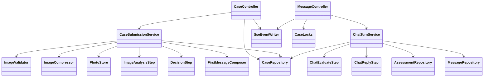
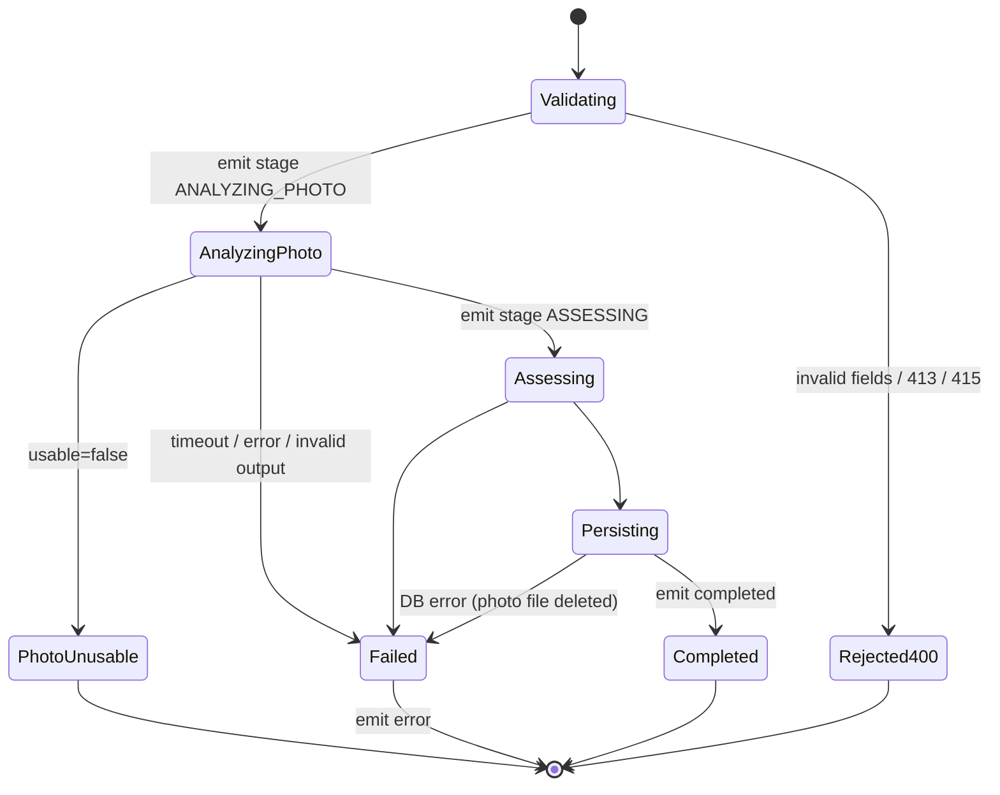
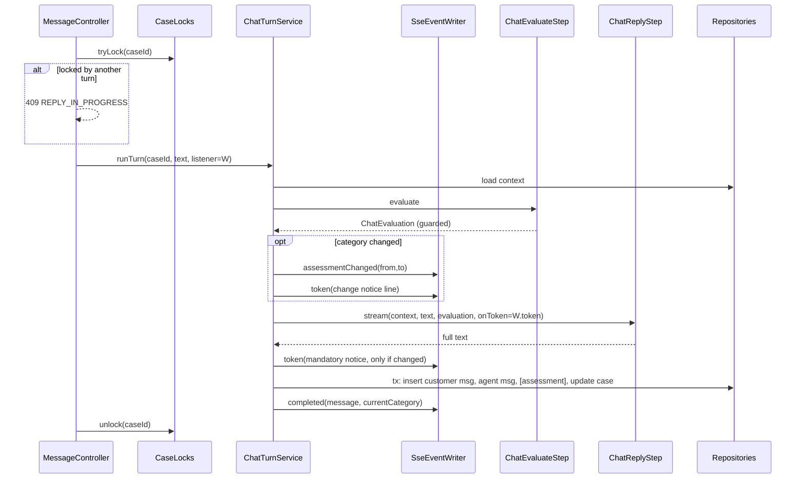

# ADR-001: Backend API, Orchestration and Image Processing

**Date:** 2026-11-25
**Status:** Accepted
**Relates to:** [`000-main-architecture.md`](000-main-architecture.md)

---

## 1. Scope

Covers the Spring Boot application in `app/backend`: HTTP and SSE endpoints, request validation, error model, image validation/compression/storage, orchestration of a submission and of a chat turn, SPA forwarding, configuration. Does **not** cover LLM prompts, SDK usage or guardrail rules ([002](002-ai-llm-integration.md)), the database schema ([003](003-persistence-and-storage.md)) or the UI ([004](004-frontend.md)).

---

## 2. Technology Documentation References

| Library | Context7 ID or official docs | Used for |
|---|---|---|
| Spring Boot 4.2.0 (Spring MVC, Validation, Actuator) | `/spring-projects/spring-boot` | Controllers, `SseEmitter`, multipart, bean validation, health |
| Spring Initializr | https://start.spring.io (metadata: `curl -H 'Accept: application/json' https://start.spring.io`) | Project generation |
| TwelveMonkeys imageio-webp 3.15.3 | `/haraldk/twelvemonkeys` | WEBP decoding (read-only) via ImageIO SPI |
| Thumbnailator 0.4.21 | https://github.com/coobird/thumbnailator | Resize, JPEG quality |
| WireMock 3.13.2 | `/wiremock/wiremock.org` | Integration tests |

---

## 3. Component Design

### Packages (under `com.devpowers.copilot`)

| Component | Responsibility |
|---|---|
| `cases.CaseController` | `POST /api/cases` (multipart → SSE), `GET /api/cases/{id}`, `GET /api/cases/{id}/photo` |
| `cases.MessageController` | `POST /api/cases/{id}/messages` (JSON → SSE) |
| `cases.CaseSubmissionService` | Orchestrates: compress → vision → (unusable? stop) → decision → guard → compose first message → persist in one transaction; emits progress through a `SubmissionListener` callback (no SSE types inside the service) |
| `cases.ChatTurnService` | Orchestrates: load context → evaluate → guard → stream reply through a `ReplyListener` → persist turn in one transaction |
| `cases.SseEventWriter` | Maps listener callbacks to named SSE events on an `SseEmitter`; the only class that knows SSE |
| `cases.CaseLocks` | In-memory per-case lock (concurrent map) preventing two simultaneous chat turns for one case → 409 |
| `imaging.ImageValidator` | Detects real format from magic bytes (JPEG `FF D8 FF`, PNG `89 50 4E 47`, WEBP `RIFF....WEBP`); rejects others regardless of the declared content type or extension |
| `imaging.ImageCompressor` | Decode (ImageIO + TwelveMonkeys WebP), apply EXIF orientation if present for JPEG, flatten alpha onto white, scale so the long edge ≤ 1568 px (never upscale), encode JPEG quality 0.8 |
| `imaging.PhotoStore` | Writes `{APP_DATA_DIR}/uploads/{caseId}.jpg`, reads it back, deletes on rollback |
| `config.AppProperties` | Typed `@ConfigurationProperties` (`app.data-dir`, `app.llm.*`) validated at startup |
| `config.ApiExceptionHandler` | Maps validation and domain exceptions to the JSON error model (non-SSE responses only) |
| `config.SpaForwardingController` | Forwards `GET` requests that are not `/api/**` and have no file extension to `/index.html` (only active when the frontend is bundled) |
| `config.StartupChecks` | Fails startup if the API key is missing or `APP_DATA_DIR` is not writable; creates `uploads/` |

### Orchestration rules
- The submission service persists **nothing** until the final assessment and first message exist; the photo file is written inside the same unit of work and deleted if the DB transaction fails (TAC-06 in 000).
- A chat turn persists the customer message, the agent message and an optional new assessment in **one** transaction after the stream finished successfully. If the stream fails or the client disconnects mid-stream, nothing is written; the frontend restores the text (AC-31).
- The submission date ("today") comes from an injected `Clock` (zone `Europe/Warsaw`) so date rules are testable.
- Each SSE request runs on a virtual thread (`spring.threads.virtual.enabled=true`). `SseEmitter` timeout = `4 × LLM_TIMEOUT_SECONDS + 15 s` for submissions (vision + repair, decision + repair; ADR-002 §5) and `3 × LLM_TIMEOUT_SECONDS + 15 s` plus no cap while reply chunks keep arriving for chat turns (the emitter timeout is reset on each `token`, or set to 0 with the inactivity timeout of ADR-002 §3.1 doing the bounding).
- Client disconnect (`IOException` on send, emitter completion callback) aborts the running SDK stream by closing it.

### Configuration (`application.yml` essentials)
- `spring.threads.virtual.enabled: true`
- `spring.servlet.multipart.max-file-size: 10MB`, `max-request-size: 11MB` (AC-08 enforced again server-side)
- `server.compression.enabled: false` (avoid any buffering of `text/event-stream`)
- `management.endpoints.web.exposure.include: health`, base path mapped so `/api/health` works (`management.endpoints.web.base-path: /api`, `management.endpoints.web.path-mapping.health: health`)
- `spring.sql.init.mode: always` (schema from `schema.sql`, see 003)
- Logging: never log the API key, base64 image data or full prompts at INFO; log case id, step, model, latency, token usage.

---

## 4. Data Structures

### `CaseSubmissionRequest` (multipart fields)
| Field | Type | Constraint |
|---|---|---|
| `caseType` | enum `COMPLAINT` \| `RETURN` | required |
| `deviceCategory` | enum: `SMARTPHONE, LAPTOP, TABLET, DESKTOP, MONITOR, TV, AUDIO, WEARABLE, CAMERA, GAME_CONSOLE, PRINTER, SMALL_APPLIANCE, OTHER` | required |
| `modelName` | string | trimmed length 2–100 |
| `purchaseDate` | ISO date | required, ≤ today (Europe/Warsaw) |
| `description` | string | ≤ 2000; required (non-blank) when `caseType=COMPLAINT` (class-level validator) |
| `photo` | file | required, ≤ 10 MB, content JPEG/PNG/WEBP by magic bytes |

### `CaseView` (GET response)
`id`, `caseType`, `deviceCategory`, `modelName`, `purchaseDate`, `description`, `photoUrl` (`/api/cases/{id}/photo`), `currentCategory`, `assessments[]` (`category`, `previousCategory`, `source`, `justification[]`, `nextSteps[]`, `createdAt`), `messages[]` (`id`, `role`, `content`, `createdAt`, `assessmentCategory?`), `createdAt`. The image analysis JSON is **not** exposed to the browser.

### `SendMessageRequest`
`content`: string, trimmed length 1–2000.

### Error model (non-SSE)
`{ "code": "VALIDATION_FAILED" | "CASE_NOT_FOUND" | "FILE_TOO_LARGE" | "UNSUPPORTED_IMAGE" | "REPLY_IN_PROGRESS" | "INTERNAL_ERROR", "message": "<Polish, user-facing>", "fieldErrors": [ { "field": "...", "message": "<Polish>" } ] }`

Polish messages match the PRD texts (e.g. `"Plik przekracza limit 10 MB."`, `"Dozwolone formaty: JPG, PNG, WEBP."`, `"Data zakupu nie może być z przyszłości."`).

### SSE events
Every event has `event:` name and a single-line JSON `data:`. Content type `text/event-stream;charset=UTF-8`, headers `Cache-Control: no-cache`, `X-Accel-Buffering: no`.

| Endpoint | Event | Data |
|---|---|---|
| submission | `stage` | `{ "stage": "ANALYZING_PHOTO" \| "ASSESSING" }` |
| submission | `photo_unusable` | `{ "reason": "BLURRED" \| "TOO_DARK" \| "NO_DEVICE" \| "CATEGORY_MISMATCH", "message": "<Polish reason + tips>" }` — terminal. `message` comes from a fixed backend map (one Polish text per `reason`), not from the LLM |
| submission | `completed` | `{ "caseId": "<uuid>" }` — terminal |
| both | `error` | `{ "code": "LLM_UNAVAILABLE" \| "LLM_INVALID_OUTPUT" \| "INTERNAL_ERROR", "message": "Usługa jest chwilowo niedostępna. Spróbuj ponownie." }` — terminal |
| chat | `assessment_changed` | `{ "from": "<category>", "to": "<category>" }` — at most once, before any `token` |
| chat | `token` | `{ "text": "<chunk>" }` |
| chat | `completed` | `{ "message": { id, role, content, createdAt, assessmentCategory? }, "currentCategory": "<category>" }` — terminal; `content` is the authoritative full text |

Exactly one terminal event per stream; the server completes the emitter right after it.

---

## 5. Interface Contracts

### `POST /api/cases`
- **Consumes:** `multipart/form-data`. **Produces:** `text/event-stream` on success path, `application/json` on pre-stream errors.
- **Pre-stream (HTTP status):** 400 `VALIDATION_FAILED` with all field errors; 413 `FILE_TOO_LARGE`; 415 `UNSUPPORTED_IMAGE`; image decode failure (corrupt file with valid magic bytes) → 415.
- **Stream:** `stage ANALYZING_PHOTO` → [`photo_unusable` | `error` | `stage ASSESSING` → (`completed` | `error`)].
- **Idempotency:** none; each successful call creates a new case.

### `GET /api/cases/{id}`
- 200 `CaseView`; 404 `CASE_NOT_FOUND` for unknown or malformed id.

### `GET /api/cases/{id}/photo`
- 200 `image/jpeg`, `Cache-Control: private, max-age=3600`; 404.

### `POST /api/cases/{id}/messages`
- **Consumes:** `application/json`. **Produces:** `text/event-stream` or JSON error.
- **Pre-stream:** 400 `VALIDATION_FAILED`; 404 `CASE_NOT_FOUND`; 409 `REPLY_IN_PROGRESS` when a turn for this case is still streaming.
- **Stream:** [`assessment_changed`] → `token`* → (`completed` | `error`).

### Internal interfaces consumed (implemented in 002 / 003)
- AI steps and composer: signatures exactly as in **ADR-002 §5** (single source; `today` is passed to `DecisionStep` and carried inside `ChatContext` for chat steps).
- Listeners owned by the `cases` package: `SubmissionListener` (`stage`, `photoUnusable`, `completed`, `error`) and `ReplyListener` (`assessmentChanged`, `token`, `completed`, `error`), implemented by `SseEventWriter`.
- Repositories: `CaseRepository`, `AssessmentRepository`, `MessageRepository` (003)

---

## 6. Technical Decisions

### D1 — Submission is one multipart request answered with SSE progress
**Status:** Accepted
**Date:** 2026-11-25
**Context:** PRD §9.1 requires stage texts ("Analizujemy zdjęcie…" → "Przygotowujemy ocenę…") and AC-30 requires all data kept on failure.
**Decision:** Single `POST /api/cases` that validates synchronously, then switches to SSE and emits `stage` events.
**Rejected alternatives:**
- Upload, then poll a job id: needs job state and a second endpoint.
- Synchronous JSON response: no real stage information; frontend would fake the step texts.
**Consequences:**
- (+) Real progress, one request, nothing stored on failure.
- (-) No byte-level upload progress (indeterminate indicator during upload).
**Review trigger:** If uploads larger than 10 MB or slow mobile networks require upload progress.

### D2 — Server-side image normalization to JPEG ≤ 1568 px, quality 0.8
**Status:** Accepted
**Date:** 2026-11-25
**Context:** AC-11 requires compression before the model; OpenRouter documents no size limit and providers vary. JDK 21 ImageIO cannot read WEBP.
**Decision:** Decode with ImageIO + TwelveMonkeys WebP plugin, flatten transparency onto white, Thumbnailator resize to long edge ≤ 1568 px, JPEG quality 0.8, store only the compressed JPEG.
**Rejected alternatives:**
- Client-side compression: AC-11 and the brief require the backend to compress; client cannot be trusted.
- scrimage-webp: wraps native libwebp binaries; heavier, platform-specific.
- Keep the original file: not needed by any AC; increases storage and data held.
**Consequences:**
- (+) Predictable request size and token cost; one storage format.
- (-) The service team sees a compressed photo only.
**Review trigger:** If the service team needs full-resolution evidence.

### D3 — Format validation by magic bytes, size by multipart limits
**Status:** Accepted
**Date:** 2026-11-25
**Context:** Content-Type and file extension are client-controlled.
**Decision:** `ImageValidator` checks the first bytes; a successful decode is required before calling the LLM.
**Rejected alternatives:**
- Trusting `Content-Type`: trivially spoofed.
**Consequences:**
- (+) Non-images never reach the model or disk.
- (-) Slight duplication with frontend checks (intended).
**Review trigger:** If more formats (HEIC) are added.

### D4 — Per-case in-memory lock for chat turns
**Status:** Accepted
**Date:** 2026-11-25
**Context:** Two parallel turns on one case (double click, two tabs) would interleave history and assessments.
**Decision:** Non-blocking `tryLock` per case id; failure → 409 `REPLY_IN_PROGRESS`.
**Rejected alternatives:**
- DB-level locking: SQLite single-writer and long streams make it unsuitable.
**Consequences:**
- (+) Simple, deterministic.
- (-) Works only for a single backend instance.
**Review trigger:** If more than one backend instance is run.

---

## 7. Diagrams

### Component diagram

### Submission state machine (SSE)

### Chat turn sequence (backend internals)

---

## 8. Testing Strategy

### Test scenarios for this area

| Scenario | Type | Input | Expected output | Edge cases |
|---|---|---|---|---|
| Valid return submission | Integration (WireMock) | multipart with PNG, RETURN, no description | SSE `stage`×2 then `completed`; 1 case, 1 assessment, 1 message rows; JPEG file exists | description empty string |
| Complaint without description | Integration | COMPLAINT, blank description | 400 `VALIDATION_FAILED`, field `description`; no WireMock request received | whitespace-only |
| Future purchase date | Unit (validator) + Integration | tomorrow (Clock fixed) | 400, `"Data zakupu nie może być z przyszłości."` | today is valid |
| Model name length | Unit | 1 / 2 / 100 / 101 chars | invalid / valid / valid / invalid | leading spaces trimmed |
| File too large | Integration | 10 MB + 1 byte | 413 `FILE_TOO_LARGE` | exactly 10 MB accepted |
| Spoofed image | Unit + Integration | `.jpg` with PDF bytes | 415 `UNSUPPORTED_IMAGE` | corrupt JPEG with valid header → 415 |
| WEBP input | Unit | WEBP with alpha | JPEG output, long edge ≤ 1568, background white | 4000×3000 → 1568×1176; 800×600 unchanged |
| Photo unusable | Integration | stub from the real category-mismatch capture (ADR-002 D6 item 2) | `photo_unusable` event with mapped Polish message, 0 rows, no file | — |
| LLM timeout | Integration | real vision capture replayed with fixed delay > timeout (test timeout 2 s) | `error LLM_UNAVAILABLE`, 0 rows | real 401 capture → `LLM_UNAVAILABLE`; capture with JSON body truncated (derived) → `LLM_INVALID_OUTPUT`; 5xx only per plan D-4 |
| DB failure on persist | Unit (mocked repo throws) | — | `error INTERNAL_ERROR`, photo file deleted | — |
| GET case | Integration | existing / unknown / malformed id | 200 view without image analysis / 404 / 404 | — |
| Chat turn no change | Integration | real chat-evaluate "unchanged" capture + streaming capture | `token`* then `completed`; 2 message rows; no `assessment_changed` | guard normalizes a proposed change back to current → same result |
| Chat turn with change | Integration | real chat-evaluate "changed" capture (physical-store statement) | `assessment_changed` before first `token`; agent content starts with `Wstępna ocena zmieniona:`; new assessment row; case `currentCategory` updated | — |
| Chat stream failure | Integration | streaming capture truncated (derived) | `error`, 0 new rows | client disconnect mid-stream → 0 rows, SDK stream closed |
| Concurrent turns | Integration | two parallel POSTs, first stream delayed | second gets 409 | lock released after error |
| SSE event mapping | Unit | listener calls | exact `event:`/`data:` lines, one terminal event | Polish characters UTF-8 |

### Technical acceptance criteria
- TAC-001-01: a Node `fetch` probe script (`app/scripts/sse-probe.mjs`; `curl` is denied to agents) against `http://localhost:8080/api/cases/{id}/messages` and through the Angular proxy at `http://localhost:4200/...` shows `token` events arriving incrementally (first event < 3 s after request with a real model), not in one block at the end.
- TAC-001-02: For any failure path in submission or chat, row counts in all three tables are unchanged and no orphan file exists in `uploads/`.
- TAC-001-03: Every SSE stream ends with exactly one of `completed`, `photo_unusable`, `error`.
- TAC-001-04: Images sent to the LLM are JPEG with long edge ≤ 1568 px (asserted on the WireMock-recorded request by decoding the data URL).
- TAC-001-05: Requests with an `Origin` other than same-origin get no CORS headers (no CORS configuration exists).
- TAC-001-06: With the frontend bundled (`-Pbundle-frontend`), `GET /case/<uuid>` returns `index.html` and `GET /api/unknown` returns 404 JSON.
