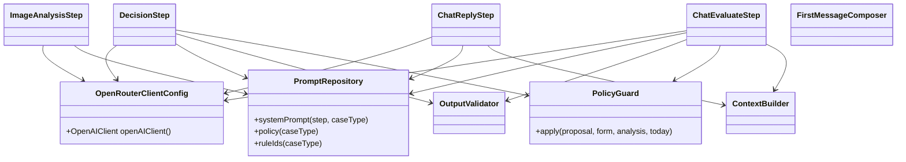
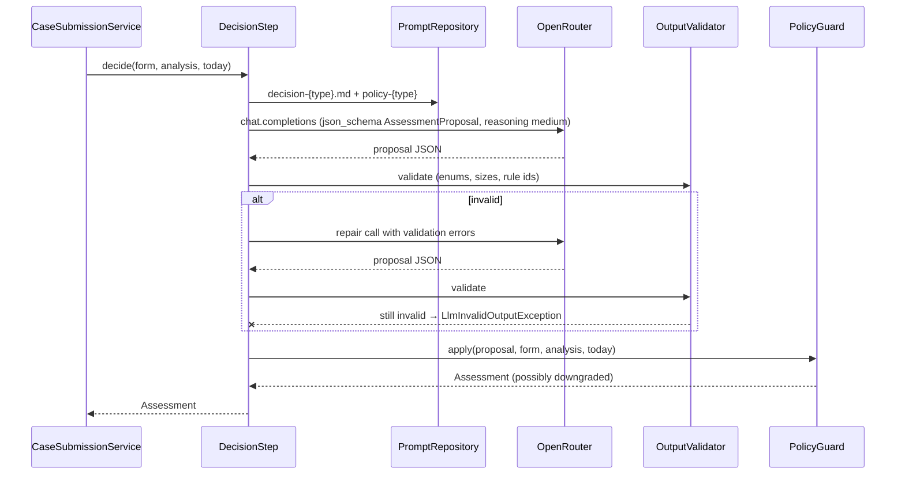
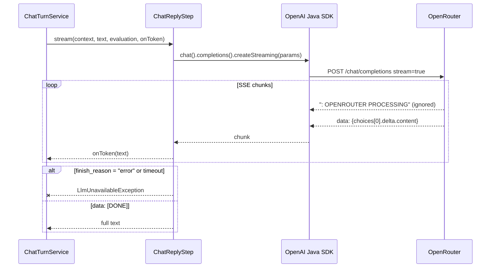

# ADR-002: AI / LLM Integration (OpenAI Java SDK + OpenRouter)

**Date:** 2026-11-25
**Status:** Accepted
**Relates to:** [`000-main-architecture.md`](000-main-architecture.md)

---

## 1. Scope

Covers the `ai` package: the OpenAI Java SDK client configured for OpenRouter, the choice between Chat Completions and Responses API, the four LLM steps (vision, decision, chat evaluate, chat reply), structured output schemas, prompts and policy documents, the `PolicyGuard`, the first-message composer, error handling and the verification spike. Does **not** cover HTTP/SSE endpoints ([001](001-backend-api.md)) or storage ([003](003-persistence-and-storage.md)).

---

## 2. Technology Documentation References

| Library / service | Context7 ID or official docs | Used for |
|---|---|---|
| OpenAI Java SDK 4.113.0 (`com.openai:openai-java`) | `/openai/openai-java`; README + `examples/` at https://github.com/openai/openai-java; https://developers.openai.com/api/docs/libraries?language=java | Client, Chat Completions, streaming, structured outputs, image input |
| OpenRouter Chat Completions | https://openrouter.ai/docs/api/reference/overview | Endpoint used |
| OpenRouter Responses API | https://openrouter.ai/docs/api/reference/responses/overview | Evaluated, rejected (D1) |
| OpenRouter streaming | https://openrouter.ai/docs/api/reference/streaming | Keep-alive comments, mid-stream errors |
| OpenRouter structured outputs | https://openrouter.ai/docs/features/structured-outputs | `response_format` json_schema |
| OpenRouter image inputs | https://openrouter.ai/docs/features/multimodal/images | base64 data URLs |
| OpenRouter reasoning tokens | https://openrouter.ai/docs/guides/best-practices/reasoning-tokens | `reasoning.effort` |
| OpenRouter SDK compatibility | https://openrouter.ai/docs/guides/features/compatibility | OpenAI SDK usage, `OPENAI_API_KEY` fallback warning |
| Model endpoints | https://openrouter.ai/api/v1/models/openai/gpt-6-luna/endpoints | Verified capabilities of the default model |

---

## 3. Component Design

### 3.1 Client configuration (`ai.OpenRouterClientConfig`)
- One `OpenAIClient` bean for the whole application (SDK guidance), built with `OpenAIOkHttpClient.builder()`:
  - `baseUrl` = `OPENROUTER_BASE_URL` (default `https://openrouter.ai/api/v1`; the SDK appends `/chat/completions`)
  - `apiKey` = `OPENROUTER_API_KEY` (never `fromEnv()`, to avoid the silent `OPENAI_API_KEY` fallback warned about by OpenRouter)
  - `timeout` = `LLM_TIMEOUT_SECONDS` (default 60 s; SDK default is 10 min)
  - `maxRetries(0)`: the PRD wants a visible failure + user retry within 60 s (AC-30); SDK retries would multiply the wait.
- Attribution header `X-OpenRouter-Title` (from `OPENROUTER_APP_TITLE`, if set) is added to every request via the SDK's client-level headers or an OkHttp interceptor (see the SDK `InterceptorsExample`). Optional; not needed for access.
- OpenRouter-specific body fields not modelled by the SDK (`reasoning`) are sent with `putAdditionalBodyProperty`.
- Jackson ≥ 2.13.4 is required by the SDK; Spring Boot 4.2 provides a newer one — verify no conflicting Jackson version is pulled in (`./mvnw dependency:tree`).

### 3.2 Steps

| Step | Model env | Streaming | Output | Reasoning effort | Input messages |
|---|---|---|---|---|---|
| `ImageAnalysisStep` | `LLM_VISION_MODEL` | No | `ImageAnalysis` via structured output (`responseFormat(ImageAnalysis.class)`) | `low` | system: `vision-{return\|complaint}.md`; user: text part (case type, category, model, description) **then** image part `data:image/jpeg;base64,...` |
| `DecisionStep` | `LLM_MODEL` | No | `AssessmentProposal` via structured output | `medium` | system: `decision-{return\|complaint}.md` + policy document + today's date; user: JSON of form data + image analysis |
| `ChatEvaluateStep` | `LLM_MODEL` | No | `ChatEvaluation` via structured output | `low` | system: `chat-evaluate.md` + policy + today's date; user: case context JSON; history; user: new customer message |
| `ChatReplyStep` | `LLM_MODEL` | Yes (`createStreaming`) | Plain Polish markdown text | `low` | system: `chat-reply-{return\|complaint}.md` + policy + today's date + evaluation result (enums and rule ids only); user: case context JSON; history; user: new customer message |

"Case context" = form data, image analysis, current assessment (category, justification, next steps). It contains customer-entered text, so it is always sent as a `user`-role message labelled as case data, never inside the system prompt. "History" = all stored messages as alternating `assistant` (AGENT) / `user` (CUSTOMER) messages, the first one being the first assessment message. Full history is re-sent on every turn (OpenRouter is stateless on both APIs; PoC conversations are short — no truncation; review trigger in D4).

### 3.3 Structured output schemas (conceptual)

**ImageAnalysis**
| Field | Type | Notes |
|---|---|---|
| `usable` | boolean | false → submission stops (AC-14) |
| `unusableReason` | enum `BLURRED, TOO_DARK, NO_DEVICE, CATEGORY_MISMATCH` or null | required when `usable=false` |
| `deviceVisible` | boolean | |
| `matchesCategory` | boolean | |
| `damageVisible` | boolean | |
| `damageTypes` | list of enum `CRACK, DENT, SCRATCH, BURN, CORROSION, DISPLAY_DEFECT, OTHER` | empty if none |
| `signsOfUse` | boolean | RETURN focus (AC-12) |
| `resalableAsNew` | boolean | RETURN focus |
| `likelyCause` | enum `MANUFACTURING_DEFECT, NORMAL_WEAR, MECHANICAL_DAMAGE, LIQUID_DAMAGE, OTHER_UNKNOWN, NOT_APPLICABLE` | COMPLAINT focus (AC-13) |
| `confidence` | enum `HIGH, MEDIUM, LOW` | |
| `observations` | string (Polish, ≤ 800 chars) | what is visible; no speculation |

**AssessmentProposal**
| Field | Type | Notes |
|---|---|---|
| `category` | enum `ACCEPT, REJECT, NEEDS_REVIEW` | AC-15 |
| `justification` | list (1–6) of `{ ruleId: string, text: string (Polish) }` | `ruleId` must exist in the policy (AC-16) |
| `nextSteps` | list (1–5) of string (Polish) | AC-16 |
| `unclearPoints` | list of string (Polish) | required non-empty when `NEEDS_REVIEW` (PRD 4.5) |
| `contradictions` | list of string (Polish) | form vs photo contradictions (AC-22) |

**ChatEvaluation**
| Field | Type |
|---|---|
| `categoryChanged` | boolean |
| `newCategory` | enum or null (required when changed) |
| `justification` | list of `{ruleId, text}` (required when changed) |
| `nextSteps` | list of string (required when changed) |
| `offTopic` | boolean (reply step then declines politely, PRD 11.2) |

All schemas are generated by the SDK from Java classes (public fields/getters, `@JsonPropertyDescription` for field guidance). Output is additionally validated in Java (enums, list sizes, rule ids); a violation triggers **one** repair call with the validation error appended, then `LlmInvalidOutputException` → SSE `error LLM_INVALID_OUTPUT`.

### 3.4 PolicyGuard (pure Java, deterministic)
Applied to `AssessmentProposal` and to `ChatEvaluation` (when changed). Input: case type, purchase date, today, image analysis, proposal. Rules (numbers read from `PolicyLimits`, a constant class asserted against the policy text by a test):

| Rule | Condition | Effect |
|---|---|---|
| G1 (AC-18) | RETURN and `today − purchaseDate > 14 days` and category = ACCEPT | category → REJECT; add justification point with return-policy rule id for the 14-day limit |
| G2 (AC-19) | RETURN and (`damageVisible` or `signsOfUse`) and category = ACCEPT | category → NEEDS_REVIEW if `confidence=LOW`, else REJECT; add rule point |
| G3 (AC-20) | COMPLAINT and `today − purchaseDate > 2 years` and category = ACCEPT | category → REJECT; add 2-year rule point |
| G4 (AC-21) | COMPLAINT and `likelyCause ∈ {MECHANICAL_DAMAGE, LIQUID_DAMAGE}` and category = ACCEPT | category → NEEDS_REVIEW if `confidence=LOW`, else REJECT; add "damage caused by user not covered" point |
| G5 (AC-22) | `contradictions` non-empty and category ≠ NEEDS_REVIEW | category → NEEDS_REVIEW |
| G6 | justification contains a `ruleId` not in the policy | drop that point; if none left → treat as invalid output (repair call) |

The guard never upgrades a category. If the guard changes the category, the final justification states the rule that forced it.

### 3.5 FirstMessageComposer (deterministic template, AC-23)
Builds the first agent message in Polish markdown, in this fixed order:
1. Greeting: `Dzień dobry,` + one line naming the case type and model.
2. Assessment line: `**Wstępna ocena: <label>**` (`Przyjęte wstępnie` / `Odrzucone wstępnie` / `Wymaga weryfikacji`); the UI also shows the badge.
3. `### Uzasadnienie` — bullet per justification point, suffixed with the rule id in parentheses.
4. For NEEDS_REVIEW: `### Do wyjaśnienia` — unclear points / contradictions.
5. `### Następne kroki` — numbered next steps.
6. Mandatory notice (exact text from PRD 11.2): `To jest wstępna ocena. Ostateczną decyzję podejmie zespół serwisowy po otrzymaniu i sprawdzeniu urządzenia.`

The LLM generates only the content items (points, steps); order and mandatory texts are guaranteed by code.

### 3.6 Chat turn composition (AC-28)
1. `ChatEvaluateStep` → guard → `ChatEvaluation`.
2. If changed: backend emits `assessment_changed` and streams the line `Wstępna ocena zmieniona: <old label> → <new label>` as the first token(s).
3. `ChatReplyStep` streams the model's explanation; its system prompt receives the evaluation result (and that the change line is already shown, so it must not repeat it).
4. If changed: backend appends the mandatory notice as the final token(s).
5. The persisted agent message = concatenation of exactly what was streamed.

### 3.7 Prompts and policies (classpath resources)

| File | Language | Content |
|---|---|---|
| `prompts/vision-return.md` | English instructions, Polish `observations` | PRD 11.1 return instructions + usability check + "not allowed" |
| `prompts/vision-complaint.md` | same | PRD 11.1 complaint instructions |
| `prompts/decision-return.md` | English instructions, Polish output | Role, category definitions, use only the attached return policy, cite rule ids, not-allowed list (PRD 11.2) |
| `prompts/decision-complaint.md` | same | Same for complaints |
| `prompts/chat-evaluate.md` | English | When a category may change (new facts only), physical-store purchase rule (PRD §8), never change because the customer insists |
| `prompts/chat-reply-return.md`, `prompts/chat-reply-complaint.md` | English instructions, Polish output | Tone (formal Polish, no emojis), off-topic handling, refuse instruction override, never request photos or personal data, never promise outcomes |
| `policies/return-policy.pl.md` | Polish | Regulamin zwrotów; content per PRD §8; every rule has a stable id `Z-<section>.<n>` (e.g. `Z-2.1` 14-day period) |
| `policies/complaint-policy.pl.md` | Polish | Regulamin reklamacji; ids `R-<section>.<n>` (e.g. `R-2.1` 2-year period, `R-4.1` mechanical damage excluded) |

- `PromptRepository` loads all files once at startup and fails startup if any is missing.
- A case uses exactly one policy (AC-17): return cases never receive the complaint policy and vice versa (asserted on recorded requests).
- Customer-provided text (model name, description, chat messages) is only ever placed in `user` messages, never concatenated into system prompts.

---

## 4. Data Structures

Domain records (Java records, immutable): `CaseForm`, `ImageAnalysis`, `AssessmentProposal`, `Assessment` (proposal after guard + `source`, `previousCategory`), `ChatContext` (form, analysis, current assessment, ordered messages, today), `ChatEvaluation`, `JustificationPoint {ruleId, text}`, `PolicyLimits` (returnDays=14, complaintYears=2).

Exceptions: `LlmUnavailableException` (timeout, connection error, HTTP ≥ 400 incl. 429/402, mid-stream `finish_reason:"error"`), `LlmInvalidOutputException` (schema/validation failure after one repair).

---

## 5. Interface Contracts

| Method | Input | Output | Errors |
|---|---|---|---|
| `ImageAnalysisStep.analyse` | `CaseForm`, JPEG bytes | `ImageAnalysis` | `LlmUnavailableException`, `LlmInvalidOutputException` |
| `DecisionStep.decide` | `CaseForm`, `ImageAnalysis`, `LocalDate today` | guarded `Assessment` | same |
| `FirstMessageComposer.compose` | `CaseForm`, `Assessment` | markdown string | — |
| `ChatEvaluateStep.evaluate` | `ChatContext`, customer text | guarded `ChatEvaluation` | same |
| `ChatReplyStep.stream` | `ChatContext`, customer text, `ChatEvaluation`, `onToken` callback, cancellation handle | full streamed text | `LlmUnavailableException` (incl. mid-stream error) |

OpenRouter wire contract used: `POST {base}/chat/completions` with `model`, `messages` (content parts `text` and `image_url` with data URL), `response_format: {type: json_schema, json_schema: {...}}` for structured steps, `stream: true` for replies, `reasoning: {effort}`. Streaming responses contain `: OPENROUTER PROCESSING` keep-alive comments (ignored by the SDK's SSE parser — verified in the spike) and end with `data: [DONE]`.

---

## 6. Technical Decisions

### D1 — Chat Completions API instead of Responses API
**Status:** Accepted
**Date:** 2026-11-25
**Context:** The user asked for a researched recommendation. Both are supported by the OpenAI Java SDK (`client.chat().completions()`, documented as "supported indefinitely", and `client.responses()`) and by OpenRouter.
**Research findings (2026-11-25):**
- OpenRouter Responses API is **stateless**: `store: true` / `previous_response_id` return 400, so the main Responses advantage (server-side conversation state) does not exist; full history must be re-sent anyway.
- OpenRouter's Responses basic-usage page shows streaming events `response.content_part.delta` / `response.done`, while the SDK maps OpenAI's `response.output_text.delta` / `response.completed`; the streaming page mentions `response.completed`. The inconsistency is a risk of silently missing deltas (unverified until a spike).
- All Responses examples on OpenRouter use `openai/*` models; Chat Completions is documented with "full support for streaming, tools, structured outputs, and vision across 400+ models".
- Both support base64 images, json_schema structured output and reasoning.
**Decision:** Chat Completions for all four steps.
**Rejected alternatives:**
- Responses API: no statefulness benefit on OpenRouter, streaming event-name risk, narrower documented model coverage.
- Mixed (Responses for vision, Completions for chat): two code paths and two sets of stubs for no gain.
**Consequences:**
- (+) Widest model compatibility; switching `LLM_MODEL` to a non-OpenAI model needs no code change.
- (+) SDK `ChatCompletionAccumulator` works with streaming.
- (-) Encrypted reasoning items are not carried between turns (history is plain text); acceptable for short conversations.
**Review trigger:** If OpenRouter makes Responses stateful, or a required feature (e.g. built-in tools) exists only in Responses and the spike confirms its streaming events parse in the SDK.

### D2 — Structured outputs + deterministic composition instead of free-text decisions
**Status:** Accepted
**Date:** 2026-11-25
**Context:** AC-15, AC-16, AC-23 need machine-readable category, rule references and a fixed message order.
**Decision:** JSON-schema structured output for vision, decision and chat evaluation; code composes user-facing first message and notices.
**Rejected alternatives:**
- Parsing categories out of free markdown: brittle, untestable.
- JSON-mode without schema: weaker guarantees.
**Consequences:**
- (+) Testable with WireMock captures; ACs verifiable in unit tests.
- (-) Requires models with `structured_outputs` support (verified for `openai/gpt-6-luna` on all 6 endpoints).
**Review trigger:** If a chosen model lacks `structured_outputs` in its OpenRouter endpoint list.

### D3 — Evaluate-then-stream for chat turns (no tool calls)
**Status:** Accepted
**Date:** 2026-11-25
**Context:** AC-28 requires the change notice at the **start** of a streamed reply and a machine-readable new category. Options researched: (a) streamed text + `update_assessment` tool call, (b) JSON output with a message field, (c) separate structured call.
**Decision:** (c) ordered first: a short non-streaming `ChatEvaluateStep`, then the streamed reply informed by its result.
**Rejected alternatives:**
- (a) Tool call: whether text and a tool call arrive in the same streamed turn is model-dependent and undocumented on OpenRouter; a tool call usually comes after or instead of text, too late for a notice at the start.
- (b) JSON with message field: user would see partial JSON or require incremental JSON parsing.
**Consequences:**
- (+) Deterministic, guard-able, testable; notice order guaranteed.
- (-) One extra small LLM call per turn (~1–3 s latency, small cost).
**Review trigger:** If chat latency (first token) exceeds 5 s at p50 in Manual QA.

### D4 — One default model `openai/gpt-6-luna`, two env variables
**Status:** Accepted
**Date:** 2026-11-25
**Context:** The user chose two configurable models. The only model verified on 2026-11-25 is `openai/gpt-6-luna` (text+image+file input, 1,050,000 context, `structured_outputs`, `reasoning`, `tools`, `response_format` on all endpoints; $0.10/M input, $0.50/M output, doubled above 272k tokens). The public model list could not be read reliably during research.
**Decision:** `LLM_VISION_MODEL` and `LLM_MODEL` both default to `openai/gpt-6-luna`; different reasoning efforts per step. Any alternative model must be checked at `https://openrouter.ai/api/v1/models/<id>/endpoints` for image input and `structured_outputs` before use.
**Rejected alternatives:**
- Hard-coding unverified alternative model IDs.
**Consequences:**
- (+) Works out of the box with the repo's `.env.example`.
- (-) No proven cost/quality split yet.
**Review trigger:** If conversations approach 272k tokens (price doubling) or vision quality is insufficient in Manual QA.

### D5 — No SDK retries; one repair call for invalid output only
**Status:** Accepted
**Date:** 2026-11-25
**Context:** AC-30: failure must surface within 60 s with a retry button.
**Decision:** `maxRetries(0)`, per-call timeout 60 s; a single repair call only for schema-invalid output (not for transport errors).
**Rejected alternatives:**
- SDK default 2 retries with backoff: can exceed the 60 s user expectation.
**Consequences:**
- (+) Predictable failure time.
- (-) Transient 429/5xx surface to the user more often.
**Review trigger:** If Manual QA shows frequent transient failures.

### D6 — Verification spike before implementation
**Status:** Accepted
**Date:** 2026-11-25
**Context:** Some facts are documented but not executed: base URL path joining, SDK parsing of OpenRouter keep-alive comments and mid-stream error chunks, json_schema + image in one call.
**Decision:** First implementation task: a throwaway integration test (or `main`) calling OpenRouter with synthetic data for (1) vision + structured output, (2) decision structured output, (3) streaming reply. Save verbatim responses (status, headers, body / SSE stream) with date, model, request summary into `src/test/resources/openrouter-captures/` (no secrets). WireMock stubs are derived only from these captures (AGENTS.md rule).
**Rejected alternatives:**
- Stubs written from documentation: may not match real responses.
**Consequences:**
- (+) Integration tests reflect reality; ADR assumptions confirmed or corrected early.
- (-) Requires a valid `OPENROUTER_API_KEY` and small spend before coding.
**Review trigger:** If any spike step fails — revisit D1 or the SDK choice and update this ADR.

---

## 7. Diagrams

### Component / class diagram

### Decision step with guard and repair

### Streaming reply internals

---

## 8. Testing Strategy

### Test scenarios for this area

| Scenario | Type | Input | Expected output | Edge cases |
|---|---|---|---|---|
| G1 late return | Unit | RETURN, purchase today−15d, proposal ACCEPT | REJECT, justification contains `Z-2.1` | exactly 14 days → ACCEPT kept |
| G2 return with signs of use | Unit | `signsOfUse=true`, HIGH / LOW confidence | REJECT / NEEDS_REVIEW | `damageVisible` only |
| G3 old complaint | Unit | COMPLAINT, purchase today−2y−1d | REJECT with 2-year rule | exactly 2 years → kept |
| G4 user-caused damage | Unit | `likelyCause=LIQUID_DAMAGE` | not ACCEPT, "not covered" point | `MANUFACTURING_DEFECT` → ACCEPT kept |
| G5 contradiction | Unit | contradictions non-empty, ACCEPT | NEEDS_REVIEW | REJECT with contradiction → NEEDS_REVIEW |
| Guard never upgrades | Unit (parameterized) | all categories × all rules | resulting category rank ≤ proposed | — |
| PolicyLimits match policy text | Unit | policy markdown | contains "14 dni" in `Z-2.1`, "2 lat" in `R-2.1` | — |
| Rule ids parsed | Unit | both policies | non-empty id sets, unique ids | — |
| First message order | Unit | each category | greeting → `**Wstępna ocena:` → `### Uzasadnienie` → `### Następne kroki` → notice (last line, exact text) | NEEDS_REVIEW includes `### Do wyjaśnienia` |
| Correct policy per type (AC-17) | Integration (WireMock request matching) | RETURN case | decision request body contains return policy marker, not complaint marker | chat turns too |
| Image request shape | Integration | PNG upload | request has text part before `image_url` part with `data:image/jpeg;base64,` | — |
| Invalid output repair | Integration | 1st response with `category:"MAYBE"`, 2nd valid | success, 2 requests | 2 invalid → `LLM_INVALID_OUTPUT` |
| Mid-stream error | Integration (capture-derived stub) | stream with `finish_reason:"error"` | `LlmUnavailableException` | keep-alive comments only then timeout |
| Base URL join | Integration | WireMock base `http://localhost:{port}/api/v1` | request path `/api/v1/chat/completions` | trailing slash in env |
| No `OPENAI_API_KEY` use | Unit | env with `OPENAI_API_KEY` set, `OPENROUTER_API_KEY` empty | startup fails | — |
| Real model smoke (spike / E2E) | E2E | synthetic photos | categories plausible, Polish output | — |

### Technical acceptance criteria
- TAC-002-01: All LLM requests go to `{OPENROUTER_BASE_URL}/chat/completions`; no request goes to `/responses` or `api.openai.com` (asserted in integration tests via WireMock "no unmatched requests").
- TAC-002-02: Every persisted assessment's category passes the guard rules G1–G5 when re-evaluated in a test against its stored inputs.
- TAC-002-03: Every first agent message ends with the exact mandatory notice text; every message that changes the category starts with `Wstępna ocena zmieniona:`.
- TAC-002-04: Spike captures for vision, decision and streaming exist in `openrouter-captures/` with date, model and request summary, and contain no API key.
- TAC-002-05: A failed LLM call surfaces as `LlmUnavailableException` within `LLM_TIMEOUT_SECONDS + 2 s`.
- TAC-002-06: No system prompt sent to OpenRouter contains customer-entered text (asserted by sending a unique marker string in the description and checking only `user`-role content contains it).
