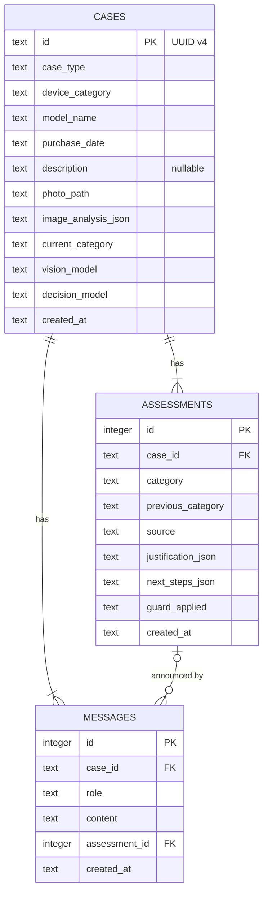
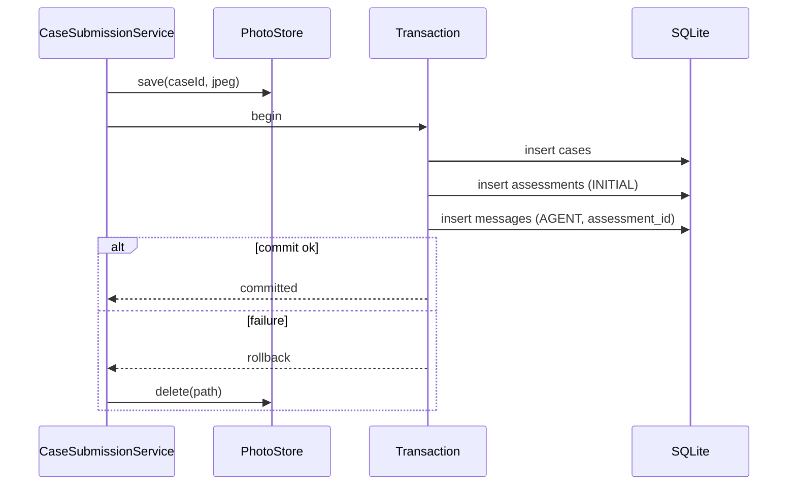
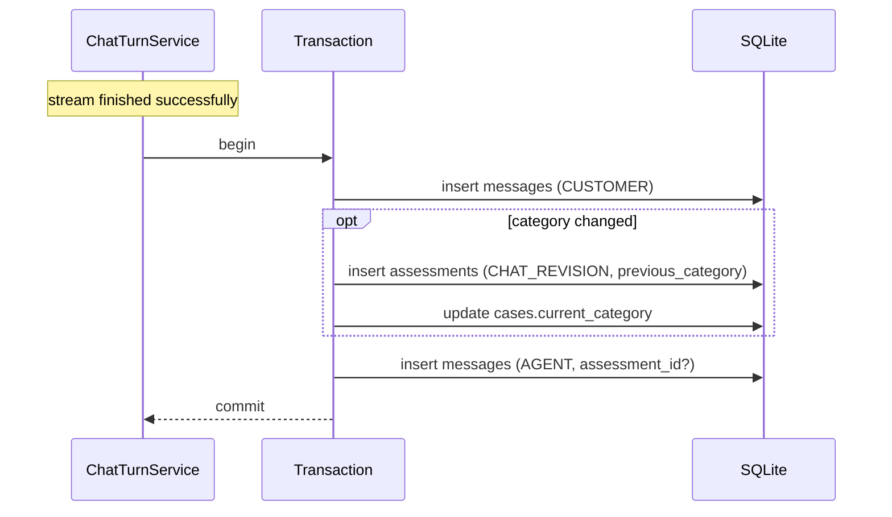

# ADR-003: Persistence and Photo Storage

**Date:** 2026-11-25
**Status:** Accepted
**Relates to:** [`000-main-architecture.md`](000-main-architecture.md)

---

## 1. Scope

Covers the SQLite database (schema, access layer, transactions, initialization) and the on-disk photo store. Implements PRD AC-32–AC-35 (session storage, resume, unique link, new case). Does **not** cover customer data / purchase history (PRD Out of Scope), retention policies (PRD §12 open question) or a service-team UI.

---

## 2. Technology Documentation References

| Library | Context7 ID or official docs | Used for |
|---|---|---|
| sqlite-jdbc 3.54.1.0 (`org.xerial:sqlite-jdbc`) | https://github.com/xerial/sqlite-jdbc | JDBC driver, connection pragmas |
| Spring Boot JDBC (`JdbcClient`, `spring.sql.init`) | `/spring-projects/spring-boot` | Data access, schema initialization, transactions |
| SQLite documentation | https://www.sqlite.org/wal.html, https://www.sqlite.org/lang_createtable.html | WAL mode, constraints |

---

## 3. Component Design

- **Database file:** `{APP_DATA_DIR}/copilot.db` (default `./data/copilot.db`, relative to the backend working directory; the root `dev` script sets `APP_DATA_DIR` to the repo-level `data/`).
- **DataSource:** Spring Boot's default pool (HikariCP) with `maximum-pool-size: 4`; JDBC URL `jdbc:sqlite:{dataDir}/copilot.db`. On every new connection: `PRAGMA foreign_keys=ON`, `PRAGMA journal_mode=WAL`, `PRAGMA busy_timeout=5000`, `PRAGMA synchronous=NORMAL` (via driver connection properties or Hikari `connection-init-sql`).
- **Schema initialization:** `src/main/resources/schema.sql` executed on startup with `spring.sql.init.mode=always`; every statement is idempotent (`CREATE TABLE IF NOT EXISTS`, `CREATE INDEX IF NOT EXISTS`).
- **Access layer:** one repository class per table using Spring `JdbcClient` with named parameters and explicit row mappers. No JPA/Hibernate.
- **Transactions:** `@Transactional` on service methods that write (`CaseSubmissionService.persist`, `ChatTurnService.persistTurn`); repositories never open their own transactions.
- **Photo store:** `{APP_DATA_DIR}/uploads/{caseId}.jpg`; DB stores the relative path `uploads/{caseId}.jpg`. Written before the DB transaction commits; deleted in a rollback hook if the transaction fails. Files are never overwritten (case ids are unique).
- **Ids:** case id = UUID v4 (from `java.util.UUID.randomUUID()`), stored as lowercase text; assessment and message ids = SQLite `INTEGER PRIMARY KEY AUTOINCREMENT`.
- **Timestamps:** stored as ISO-8601 UTC text with milliseconds (`2026-11-25T10:15:30.123Z`) from the injected `Clock`; purchase date as ISO date text.

---

## 4. Data Structures

### Table `cases`
| Column | Type | Constraints |
|---|---|---|
| `id` | TEXT | PRIMARY KEY (UUID v4) |
| `case_type` | TEXT | NOT NULL, CHECK IN ('COMPLAINT','RETURN') |
| `device_category` | TEXT | NOT NULL (enum name from 001 §4) |
| `model_name` | TEXT | NOT NULL, length 2–100 |
| `purchase_date` | TEXT | NOT NULL, ISO date |
| `description` | TEXT | NULL allowed (RETURN) |
| `photo_path` | TEXT | NOT NULL |
| `image_analysis_json` | TEXT | NOT NULL (serialized `ImageAnalysis`, see 002 §3.3) |
| `current_category` | TEXT | NOT NULL, CHECK IN ('ACCEPT','REJECT','NEEDS_REVIEW') |
| `vision_model` | TEXT | NOT NULL (model id used, for the service team) |
| `decision_model` | TEXT | NOT NULL |
| `created_at` | TEXT | NOT NULL |

### Table `assessments`
| Column | Type | Constraints |
|---|---|---|
| `id` | INTEGER | PRIMARY KEY AUTOINCREMENT |
| `case_id` | TEXT | NOT NULL, FK → `cases.id` ON DELETE CASCADE |
| `category` | TEXT | NOT NULL, CHECK IN (…) |
| `previous_category` | TEXT | NULL for the initial assessment |
| `source` | TEXT | NOT NULL, CHECK IN ('INITIAL','CHAT_REVISION') |
| `justification_json` | TEXT | NOT NULL (array of `{ruleId, text}`) |
| `next_steps_json` | TEXT | NOT NULL (array of strings) |
| `guard_applied` | TEXT | NULL or comma-separated guard rule ids (e.g. `G1`) — audit of overrides |
| `created_at` | TEXT | NOT NULL |

Index: `idx_assessments_case (case_id, id)`.

### Table `messages`
| Column | Type | Constraints |
|---|---|---|
| `id` | INTEGER | PRIMARY KEY AUTOINCREMENT |
| `case_id` | TEXT | NOT NULL, FK → `cases.id` ON DELETE CASCADE |
| `role` | TEXT | NOT NULL, CHECK IN ('AGENT','CUSTOMER') |
| `content` | TEXT | NOT NULL (CUSTOMER ≤ 2000 chars) |
| `assessment_id` | INTEGER | NULL, FK → `assessments.id` (set on the first message and on messages announcing a change) |
| `created_at` | TEXT | NOT NULL |

Index: `idx_messages_case (case_id, id)`. Message order = `id` ascending (monotonic within the single writer).

### Invariants
- I1: Every case has ≥ 1 assessment with `source=INITIAL` and ≥ 1 message (`role=AGENT`, linked to that assessment).
- I2: `cases.current_category` equals the `category` of the assessment with the highest `id` for that case.
- I3: Messages for a case alternate CUSTOMER → AGENT after the first AGENT message (written in pairs per turn).
- I4: `photo_path` file exists for every case row.

---

## 5. Interface Contracts

| Repository method | Input | Output | Notes |
|---|---|---|---|
| `CaseRepository.insert(CaseRecord)` | full case row | — | inside submission transaction |
| `CaseRepository.findById(String id)` | id | `Optional<CaseRecord>` | malformed id → empty |
| `CaseRepository.updateCurrentCategory(id, category)` | | rows updated (must be 1) | inside turn transaction |
| `AssessmentRepository.insert(AssessmentRecord)` | | generated id | |
| `AssessmentRepository.findByCase(id)` | | list ordered by id | |
| `MessageRepository.insert(MessageRecord)` | | generated id | |
| `MessageRepository.findByCase(id)` | | list ordered by id | |
| `PhotoStore.save(caseId, jpegBytes)` | | relative path | creates `uploads/` if missing |
| `PhotoStore.open(relativePath)` | | byte stream | rejects paths outside `uploads/` |
| `PhotoStore.delete(relativePath)` | | — | used on rollback |

---

## 6. Technical Decisions

### D1 — SQLite file + `JdbcClient` (no JPA)
**Status:** Accepted
**Date:** 2026-11-25
**Context:** User chose SQLite. Three small tables, append-mostly, single instance.
**Decision:** `sqlite-jdbc` with Spring `JdbcClient` and hand-written SQL.
**Rejected alternatives:**
- JPA + Hibernate community SQLite dialect: latest artifact is a pre-release (8.0.0.CR2) and adds mapping complexity for three tables.
- PostgreSQL in Docker: infrastructure not needed for a PoC.
**Consequences:**
- (+) Zero infrastructure, transparent SQL, easy to inspect with `sqlite3`.
- (-) Single writer; not suitable for multiple backend instances.
**Review trigger:** If more than one backend instance is needed or write contention appears (`SQLITE_BUSY` in logs).

### D2 — `schema.sql` initialization instead of Flyway
**Status:** Accepted
**Date:** 2026-11-25
**Context:** Flyway 13.13.0 keeps SQLite support inside `flyway-core` (no separate `flyway-database-sqlite` artifact on Maven Central); support tier and SQLite's limited `ALTER TABLE` were not verified for this setup. The PoC schema is created once.
**Decision:** Idempotent `schema.sql` run by `spring.sql.init`.
**Rejected alternatives:**
- Flyway now: unverified SQLite support path; versioned migrations not needed before any data must be preserved.
**Consequences:**
- (+) No extra dependency; trivial to reset by deleting `data/copilot.db`.
- (-) Schema changes after real data exists need manual handling.
**Review trigger:** The first schema change after data must be preserved → introduce Flyway (verify SQLite support in `flyway-core` first).

### D3 — Photos on disk, path in DB; store compressed JPEG only
**Status:** Accepted
**Date:** 2026-11-25
**Context:** User chose "SQLite + photos on disk". AC-32 requires the photo to be stored with the session.
**Decision:** Store only the compressed JPEG (001 D2) at `uploads/{caseId}.jpg`.
**Rejected alternatives:**
- BLOB in SQLite: larger DB file, slower backups and inspection.
**Consequences:**
- (+) Small DB, photos easy to inspect.
- (-) DB and files must be backed up together; consistency handled by rollback deletion.
**Review trigger:** If data must be moved between machines often (then consider BLOBs or object storage).

### D4 — Persist only completed units of work
**Status:** Accepted
**Date:** 2026-11-25
**Context:** AC-30/31: on failure no partial assessment is shown and the customer's text is restored, so storing partial state would desynchronize UI and DB.
**Decision:** A submission is stored only after the first message exists; a chat turn (customer message + agent message + optional assessment + case update) is stored in one transaction after the stream completes.
**Rejected alternatives:**
- Store customer message immediately: resend after failure would duplicate it.
**Consequences:**
- (+) DB always satisfies invariants I1–I4.
- (-) Failed attempts are not audited (acceptable for PoC; logged at WARN with case id).
**Review trigger:** If the service team needs an audit of failed attempts.

---

## 7. Diagrams

### Entity relationship diagram

### Submission persistence sequence

### Chat turn persistence sequence

---

## 8. Testing Strategy

### Test scenarios for this area

| Scenario | Type | Input | Expected output | Edge cases |
|---|---|---|---|---|
| Schema idempotent | Integration (temp dir) | start app twice on same DB | no error, tables unchanged | empty data dir created |
| Pragmas active | Integration | new connection | `foreign_keys=1`, `journal_mode=wal` | — |
| Insert + read case | Integration | full case | `findById` returns equal record; `description` null round-trips | Polish characters (ąęłńóśźż) |
| Unknown / malformed id | Integration | random UUID / `abc` | empty | SQL-injection-like string |
| Ordering | Integration | 5 messages inserted | returned by ascending id | same `created_at` ms |
| Submission rollback | Integration | message insert forced to fail | no rows in any table; photo file deleted | — |
| Turn rollback | Integration | assessment insert fails | no new message rows; `current_category` unchanged | — |
| Invariant I2 | Integration | revision turn | `current_category` = last assessment | two revisions in a row |
| FK cascade | Integration | delete case (test only) | assessments/messages removed | — |
| Path traversal | Unit | `PhotoStore.open("../copilot.db")` | rejected | absolute paths |
| CHECK constraints | Integration | invalid category string | SQL constraint error | — |

### Technical acceptance criteria
- TAC-003-01: Deleting `data/` and starting the backend recreates `copilot.db` with all tables and `uploads/`.
- TAC-003-02: After any successful submission, invariants I1–I4 hold (asserted by a test helper run after each integration test).
- TAC-003-03: After any failed submission or chat turn, table row counts and the number of files in `uploads/` are unchanged.
- TAC-003-04: `data/` is listed in `.gitignore`, and `git status` shows no DB or upload files after running the test suite.
- TAC-003-05: Integration tests use a fresh temp data directory per test class; no test touches the developer's `data/`.
