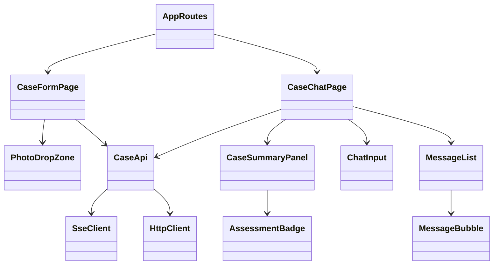
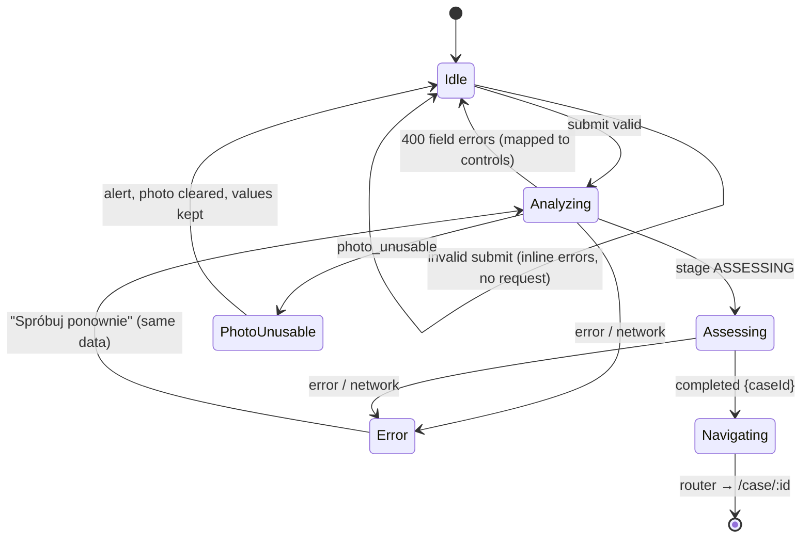
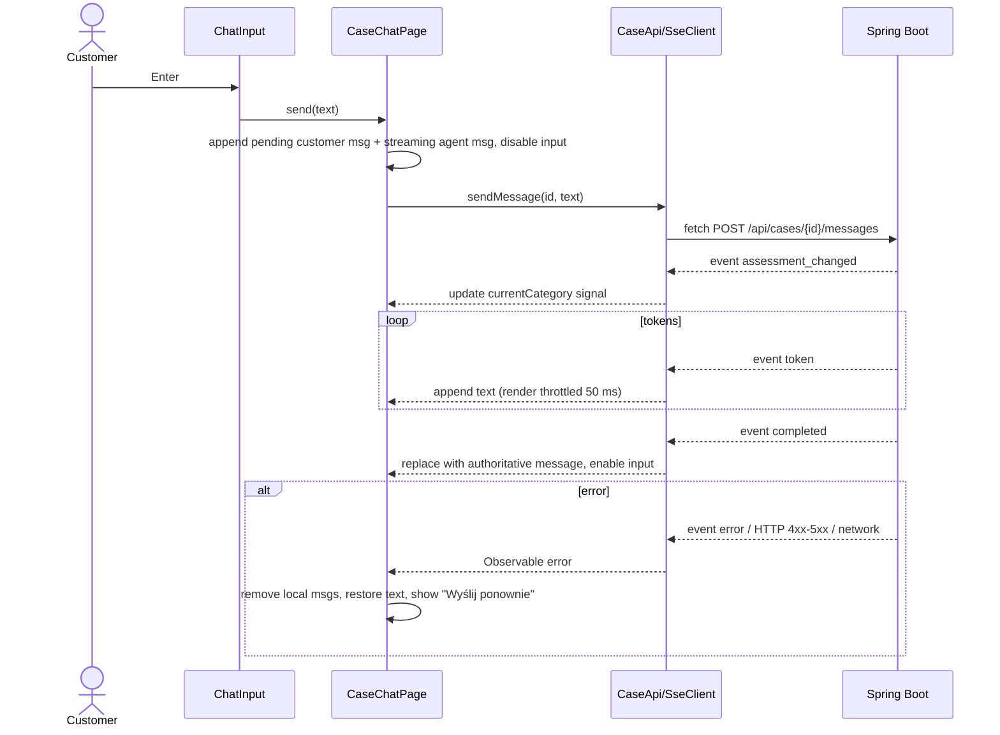

# ADR-004: Frontend (Angular 22 + Angular Material)

**Date:** 2026-11-25
**Status:** Accepted
**Relates to:** [`000-main-architecture.md`](000-main-architecture.md)

---

## 1. Scope

Covers the Angular SPA in `app/frontend`: project initialization, theming with the DevPowers brand tokens, routing, the case form, the chat screen, the SSE client, markdown rendering, integration with the Spring Boot backend (dev proxy and bundled mode) and frontend tests. UI behavior and texts come from PRD §9; visual tokens from `docs/design-guidelines.md` and `assets/design-tokens.json`. Does **not** cover backend contracts beyond consuming them ([001](001-backend-api.md)).

---

## 2. Technology Documentation References

| Library | Context7 ID or official docs | Version | Used for |
|---|---|---|---|
| Angular (core, router, forms, common/http) | `/websites/angular_dev` | 22.3.0 | Framework, signals, zoneless, reactive forms |
| Angular CLI | `/angular/angular-cli`; https://angular.dev/cli/new | 22.3.0 | `ng new`, `ng add`, Vitest builder, dev-server proxy |
| Angular Material / CDK | `/angular/components`, `/angular/material2-docs-content`; https://material.angular.dev/guide/theming | 22.3.0 | Components, M3 theming, harnesses, `cdkTextareaAutosize` |
| Material date-fns adapter | https://material.angular.dev/components/datepicker/overview | 22.3.0 + `date-fns` (`pl` locale) | Polish date input/format |
| ngx-markdown | `/jfcere/ngx-markdown` | 22.1.1 (peer `marked` ^17 \|\| ^18) | Agent markdown rendering, sanitized |
| Vitest | `/vitest-dev/vitest` (via `@angular/build:unit-test`) | CLI default | Unit tests |
| Playwright | https://playwright.dev/docs/intro | 1.65.1 | E2E, Manual QA screenshots |
| Angular versions/Node support | https://angular.dev/reference/versions | — | Node `^22.22.3 \|\| ^24.15.0 \|\| >=26`; TypeScript `>=6.0 <6.1` (VM has Node 24.21 ✓) |

---

## 3. Component Design

### 3.1 Application setup
- Standalone components only, **zoneless** change detection (default since Angular 21; do not add `provideZoneChangeDetection`), signals for component state, `OnPush`-equivalent by default.
- Providers in `app.config.ts`: `provideRouter(routes, withComponentInputBinding())`, `provideHttpClient()` (fetch backend default), `provideMarkdown()` (ngx-markdown, default sanitization kept), `provideDateFnsAdapter()` with display format `dd.MM.yyyy`, `MAT_DATE_LOCALE` = `pl` from `date-fns/locale`, `LOCALE_ID` = `'pl'` with `registerLocaleData(localePl)`.
- Fonts: brand fonts from Google Fonts as specified in `docs/design-guidelines.md` (replace Roboto added by `ng add`), Material Symbols kept for icons.

### 3.2 Routes

| Path | Component | Notes |
|---|---|---|
| `''` | `CaseFormPage` | Empty form |
| `'case/:id'` | `CaseChatPage` | Loads case via `GET /api/cases/{id}`; 404 → `CaseNotFound` view in the same page |
| `'**'` | redirect to `''` | |

### 3.3 Components and services

| Unit | Responsibility |
|---|---|
| `core/api/CaseApi` | `getCase(id)` via `HttpClient`; `submitCase(formData)` and `sendMessage(id, text)` via `SseClient` |
| `core/sse/SseClient` | `post(url, body): Observable<SseEvent>` using `fetch` with `AbortController`; parses `text/event-stream` (split on blank line, read `event:`/`data:`, ignore comment lines starting with `:`); non-2xx → reads JSON error body and errors the Observable with `ApiError`; unsubscribe → `abort()` |
| `core/models` | TypeScript types mirroring 001 §4 (`CaseView`, `SseEvent` union, enums, `ApiError`) |
| `features/case-form/CaseFormPage` | Reactive form, client validation (AC-02…AC-09), submission state machine, stage texts, unusable-photo and error alerts |
| `shared/photo-drop-zone/PhotoDropZone` | Hidden `<input type=file accept="image/jpeg,image/png,image/webp">` + drag & drop area; validates type (accepted when the browser MIME type **or** the extension is one of jpg/jpeg/png/webp — a mismatch between extension and real content, like `assets/example-images/laptop-1.png` which is a JPEG, must be accepted; the backend checks magic bytes) and size ≤ 10 MB before upload; preview via `URL.createObjectURL` (revoked on change/destroy); implements `ControlValueAccessor` |
| `features/case-chat/CaseChatPage` | Loads case, holds `messages` signal and `currentCategory` signal, sends messages, handles streaming, retry |
| `features/case-chat/CaseSummaryPanel` | Case type, category, model, date, thumbnail (click → `MatDialog` with full photo), assessment badge; collapsible (`mat-expansion-panel`) under 768 px |
| `features/case-chat/MessageList` | `@for` over messages; agent left / customer right; auto-scroll to bottom when a message is added or streamed text grows (only if the user is near the bottom) |
| `features/case-chat/MessageBubble` | Agent: `<markdown [data]>`; customer: plain text with preserved line breaks; change notice and badge styling |
| `features/case-chat/ChatInput` | `matInput` + `cdkTextareaAutosize`, counter `n/2000`, Enter sends, Shift+Enter newline, disabled while streaming |
| `shared/assessment-badge/AssessmentBadge` | Maps category → Polish label + brand color (ACCEPT `--positive`, REJECT `--negative`, NEEDS_REVIEW `--accent-warm`) + icon (not color-only) |

### 3.4 Form (Material mapping)

| Field | Material component | Validation / behavior |
|---|---|---|
| Case type | `mat-button-toggle-group` (Reklamacja / Zwrot), nothing preselected | required; switching updates description `required` validator and hint without clearing values (AC-03) |
| Device category | `mat-select` | required; 13 options, Polish labels |
| Model name | `matInput` | required, 2–100 after trim |
| Purchase date | `matDatepicker` with `[max]="today"` | required; typed future date → `"Data zakupu nie może być z przyszłości."` (AC-04) |
| Description | `matInput` textarea + `mat-hint align="end"` counter | maxlength 2000; required for COMPLAINT |
| Photo | `PhotoDropZone` | required; type/size messages from AC-07/08 |
| Submit | `mat-flat-button` | marks all touched; invalid → no request (AC-09) |

Submission states: `idle → uploading/analyzing ("Analizujemy zdjęcie…") → assessing ("Przygotowujemy ocenę…") → navigate`; `photo_unusable → idle` with alert, photo control reset, others kept (AC-14); `error → idle` with alert + "Spróbuj ponownie" resubmitting the same `FormData` incl. photo (AC-30). During processing the form is disabled and a `mat-progress-bar` (indeterminate) is shown (AC-10).

### 3.5 Chat streaming state
- On send: append customer message (local, `pending`), append empty agent message (`streaming`), disable input, show typing indicator until the first `token`.
- `assessment_changed` → set `currentCategory` immediately (summary badge updates, AC-28).
- `token` → append text to the streaming message; markdown re-render throttled to at most every 50 ms.
- `completed` → replace the streaming message with `message` from the event (authoritative content), mark customer message as sent, set `currentCategory`.
- `error` or HTTP error → remove both local messages, put the text back into the input, show inline error with "Wyślij ponownie" (AC-31). 409 → same handling with message "Poprzednia odpowiedź jest jeszcze generowana."
- Leaving the page unsubscribes → `fetch` aborted → backend stops the stream and persists nothing.

### 3.6 Theming
- `src/styles/tokens.scss`: the brand CSS variables from `docs/design-guidelines.md` (`--surface`, `--surface-raised`, `--on-surface`, `--accent`, `--accent-warm`, `--positive`, `--negative`, `--chat-client`, `--chat-agent`, `--hairline`, `--shadow`, …) are the single source of truth.
- `src/styles/material-theme.scss`: `@include mat.theme(...)` on `html` with `theme-type: light`, brand typography, density 0, and `$overrides` mapping Material system tokens to the brand variables (e.g. primary → `--surface-strong`, error → `--negative`, surface → `--surface`, on-surface → `--on-surface`, outline → `--hairline`); corner shape tokens set to the brand radii from `design-tokens.json`.
- Hard drop shadows and thick outlines (brand signature) are plain CSS on brand classes plus targeted `mat.<component>-overrides(...)`; Material elevation tokens are not used for them.
- Chat bubbles: agent `--chat-agent`, customer `--chat-client`.
- Dark theme: out of scope for the PoC (PRD does not require it); tokens kept so it can be added later.

---

## 4. Data Structures

TypeScript mirrors of backend contracts (001 §4):
- `CaseType = 'COMPLAINT' | 'RETURN'`, `DeviceCategory` (13 values), `AssessmentCategory = 'ACCEPT' | 'REJECT' | 'NEEDS_REVIEW'`.
- `CaseView`, `AssessmentView`, `MessageView` (as in 001).
- `SseEvent` discriminated union: `{type:'stage', stage}`, `{type:'photo_unusable', reason, message}`, `{type:'completed', caseId}` (submission) / `{type:'completed', message, currentCategory}` (chat), `{type:'assessment_changed', from, to}`, `{type:'token', text}`, `{type:'error', code, message}`.
- `ChatMessageVm`: `MessageView` + `status: 'sent' | 'pending' | 'streaming'`.
- Label maps (Polish): case types, device categories (Smartfon, Laptop, Tablet, Komputer stacjonarny, Monitor, Telewizor, Słuchawki / audio, Smartwatch / urządzenie ubieralne, Aparat fotograficzny, Konsola do gier, Drukarka, Małe AGD, Inne), assessment categories (Przyjęte wstępnie, Odrzucone wstępnie, Wymaga weryfikacji).

---

## 5. Interface Contracts

Consumed (same-origin `/api`, see 001 §5):
- `POST /api/cases` — `FormData` with fields `caseType`, `deviceCategory`, `modelName`, `purchaseDate` (`yyyy-MM-dd`), `description` (omitted if empty), `photo`. No manual `Content-Type` header (browser sets the multipart boundary).
- `GET /api/cases/{id}` — JSON.
- `GET /api/cases/{id}/photo` — `` source.
- `POST /api/cases/{id}/messages` — JSON `{content}`, `Accept: text/event-stream`.

Server-side field errors (400) are mapped onto the matching form controls; unknown fields → general alert.

---

## 6. Initialization and Integration with Spring Boot

### 6.1 Create the Angular project (from the repository root)
1. Check the CLI options first: `npx @angular/cli@22.3.0 new --help`.
2. Generate: `npx @angular/cli@22.3.0 new frontend --directory app/frontend --style=scss --routing --ssr=false --skip-git --defaults` (standalone, zoneless and Vitest are CLI defaults in 22.x; optionally `--ai-config claude-code`).
3. In `app/frontend`: `npx ng add @angular/material@22.3.0` → choose **Custom** theme, enable global typography. Then replace the generated theme with `material-theme.scss` + `tokens.scss` (3.6).
4. Install: `npm install ngx-markdown@22.1.1 marked@<version satisfying ngx-markdown's peer range> @angular/material-date-fns-adapter@22.3.0 date-fns`.
5. Add `proxy.conf.json` with `/api` → `http://localhost:8080` (`secure: false`) and reference it via `proxyConfig` in the `serve` target of `angular.json`.
6. Verify: `npx ng test --no-watch` and `npx ng build` pass on the empty scaffold before writing features.

### 6.2 How the parts work together
- **Browser ↔ Angular dev server (`:4200`) ↔ Spring Boot (`:8080`):** the dev server serves the SPA and proxies `/api/**` to Spring Boot, so the browser sees one origin and no CORS is configured.
- **Spring Boot ↔ OpenRouter:** only the backend holds `OPENROUTER_API_KEY` and calls OpenRouter through the OpenAI Java SDK (002). The SDK's blocking stream runs on a virtual thread; each delta is written to an `SseEmitter` as a `token` event; Angular's `SseClient` reads it from `fetch`'s `ReadableStream`.
- **SSE through the proxy:** backend sends `Cache-Control: no-cache`, `X-Accel-Buffering: no`, compression disabled. During integration, verify incremental delivery with the Node `fetch` probe (`app/scripts/sse-probe.mjs`) on `:8080` and on `:4200` (TAC-001-01; agents may not run `curl`). If the dev proxy buffers, fallback: call the backend directly on `:8080` from the SPA in dev with a CORS mapping limited to `http://localhost:4200` (record it here if used).
- **One-command dev start:** root `app/package.json` script `dev` runs `./mvnw spring-boot:run` (in `app/backend`) and `ng serve` (in `app/frontend`) concurrently, after loading `.env`.
- **Bundled mode:** `./mvnw -Pbundle-frontend package` runs frontend-maven-plugin 2.0.2 (installs a local Node 24, `npm ci`, `npm run build`), copies `app/frontend/dist/frontend/browser` into `target/classes/static`; Spring Boot serves the SPA and `SpaForwardingController` forwards client routes such as `/case/{id}` to `index.html`.

---

## 7. Technical Decisions

### D1 — Custom chat built from Angular Material primitives (no chat library)
**Status:** Accepted
**Date:** 2026-11-25
**Context:** The user asked for ready-to-use chat/streaming components for Angular Material. Research (2026-11-25): no maintained Material-styled chat component exists. `deep-chat` 2.5.1 (MIT, web component, SSE streaming support) works in Angular via `CUSTOM_ELEMENTS_SCHEMA` but ships its own styling and markdown renderer; `@nlux` has no Angular package; Kendo Conversational UI 26.1.0 is commercial; `@pheme-ai/chat` 0.2.0 and `@tailng-ui/ai` 0.2.2 are immature; `ngx-chat-ui` is abandoned (2019).
**Decision:** Build the chat from Material/CDK pieces (cards/divs, `matInput` + `cdkTextareaAutosize`, `mat-progress-bar`/CSS typing dots, `mat-expansion-panel`, `MatDialog`) and ngx-markdown.
**Rejected alternatives:**
- deep-chat: conflicts with the brand tokens and Material theme; its built-in request handling would bypass our SSE event contract (`assessment_changed`, `completed`).
- Kendo: commercial license.
- CDK virtual scroll: unnecessary at PoC message counts and complicates growing streamed messages.
**Consequences:**
- (+) Full control over brand styling, Polish texts, our event protocol and accessibility.
- (-) ~5 small components to write and test.
**Review trigger:** If a maintained Angular Material chat component appears or chat UI scope grows (attachments, reactions).

### D2 — Own `fetch`-based SSE client
**Status:** Accepted
**Date:** 2026-11-25
**Context:** Both streams are POST requests (multipart / JSON). `EventSource` supports only GET without body. `@microsoft/fetch-event-source` 2.0.1 was last published 2021-04-25. Angular `HttpClient` download-progress `partialText` would require re-parsing a growing string and its incremental behavior on the fetch backend is unverified.
**Decision:** ~60-line `SseClient` service: `fetch` + `response.body.pipeThrough(new TextDecoderStream())` + minimal SSE parser, wrapped in an RxJS `Observable` with `AbortController` teardown.
**Rejected alternatives:**
- `EventSource`: GET-only.
- `@microsoft/fetch-event-source`: unmaintained.
- `HttpClient` progress events: unverified incremental delivery, awkward parsing.
**Consequences:**
- (+) No dependency, fully unit-testable with a fake `ReadableStream`.
- (-) `HttpClient` interceptors do not apply to these two calls (none are needed: no auth).
**Review trigger:** If authentication headers or global interceptors are introduced.

### D3 — Reactive forms + signals, zoneless
**Status:** Accepted
**Date:** 2026-11-25
**Context:** Angular 22 defaults to zoneless and signals; the form needs cross-field validation (description required for complaints).
**Decision:** Typed reactive forms for the case form; signals for page state; no state library.
**Rejected alternatives:**
- NgRx/signal store: overkill for two screens.
- Template-driven forms: weaker for conditional validators.
**Consequences:**
- (+) Simple, current Angular idioms.
- (-) Must remember zoneless rules (no reliance on zone-triggered change detection in third-party callbacks; update signals instead).
**Review trigger:** If the app grows beyond ~5 screens with shared state.

### D4 — date-fns adapter with Polish locale
**Status:** Accepted
**Date:** 2026-11-25
**Context:** The native date adapter parses typed `dd.MM.yyyy` poorly.
**Decision:** `@angular/material-date-fns-adapter` with `pl` locale, display/parse format `dd.MM.yyyy`; values sent as `yyyy-MM-dd`.
**Rejected alternatives:**
- Native adapter: unreliable Polish input parsing.
- Luxon/Moment adapters: larger or deprecated.
**Consequences:**
- (+) Correct Polish input and calendar (Monday first).
- (-) Extra dependency (`date-fns`).
**Review trigger:** None expected for the PoC.

### D5 — Brand tokens as CSS variables mapped onto Material M3 system tokens
**Status:** Accepted
**Date:** 2026-11-25
**Context:** Manual QA compares screens with `assets/homepage.png` and `docs/design-guidelines.md`.
**Decision:** `tokens.scss` is the source; `mat.theme` `$overrides` and component overrides consume it; hard shadows as plain CSS.
**Rejected alternatives:**
- Prebuilt Material theme: does not match the brand.
- Tailwind next to Material: two styling systems for one small app.
**Consequences:**
- (+) One place to change brand colors.
- (-) Some Material components need targeted overrides for square corners/hard shadows.
**Review trigger:** If dark mode is added (map the dark token set).

---

## 8. Diagrams

### Component diagram

### Form submission state

### Chat send with streaming

---

## 9. Testing Strategy

### Test scenarios for this area

| Scenario | Type | Input | Expected output | Edge cases |
|---|---|---|---|---|
| Required fields (AC-02, AC-09) | Unit (harnesses) | submit empty form | inline error under each required field; `CaseApi.submitCase` not called | — |
| Description conditional (AC-03) | Unit | toggle COMPLAINT ↔ RETURN with text entered | required marker toggles, text kept | blank description + COMPLAINT invalid |
| Future date (AC-04) | Unit | typed tomorrow | error text exact | today valid; `[max]` disables future days |
| Model/description lengths (AC-05) | Unit | 1/101 chars; 2001 chars | errors; counter shows `n/2000` | — |
| Photo type/size (AC-07, AC-08) | Unit (`PhotoDropZone`) | `.gif`, 10 MB + 1 B file | exact Polish messages, no preview | second file replaces first (AC-06) |
| Submission states (AC-10, AC-14, AC-30) | Unit (fake `CaseApi` Observable) | stage → photo_unusable / error / completed | stage texts, disabled form, photo cleared only on unusable, navigation on completed | 400 field errors mapped |
| SSE parser | Unit | chunks splitting events and multibyte Polish chars at arbitrary boundaries; `:` comment lines | correct event sequence | missing terminal event → error; non-2xx JSON → `ApiError` |
| SSE abort | Unit | unsubscribe mid-stream | `AbortController.abort()` called | — |
| Chat streaming (AC-27, AC-28) | Unit | events assessment_changed, token×n, completed | badge updates first; input disabled until completed; final content = `completed.message.content` | — |
| Chat error (AC-31) | Unit | error event | local msgs removed, text restored, retry visible | 409 message |
| Markdown (AC-29) | Unit | `**bold**`, list, `<script>` | rendered HTML, no raw markup, script stripped | — |
| Not found (PRD 9.3) | Unit | GET 404 | "Nie znaleziono zgłoszenia" + button | — |
| Validation on blur | Unit | focus and leave a required field empty | inline error shown without submit (PRD §9.1) | — |
| Enter / Shift+Enter | Unit | keydown Enter / Shift+Enter in chat input | send / newline (PRD §9.2) | Enter while streaming does nothing |
| Responsive (AC-37) | E2E (Chromium + Firefox projects) | viewport 360×740 | no horizontal scroll on both screens | summary panel collapsed |
| Full return flow | E2E (real stack) | photos from `assets/example-images/` (each at least once, `setInputFiles`), date today−3d | chat with badge, sections, notice; reload restores (AC-33) | `laptop-1.png` (JPEG content) accepted |
| Late return | E2E | any example photo, date today−30d | badge is not "Przyjęte wstępnie"; 14-day rule cited | — |
| Physical-store revision (AC-28) | E2E | return with today−3d; chat: "Kupiłem to urządzenie w sklepie stacjonarnym." | **a change is required**: notice `Wstępna ocena zmieniona:` at the start and badge updated; if the first assessment was already REJECT and no change occurs, the test records it and repeats with another photo once, then fails | model nondeterminism otherwise handled by asserting structure only |

### Technical acceptance criteria
- TAC-004-01: `npx ng test --no-watch` and `npx ng build` pass with zero errors and zero new warnings; production bundle contains no `OPENROUTER` string.
- TAC-004-02: All user-visible strings are Polish; a unit test scans the label maps and templates for the English words "Submit", "Error", "Loading" (none found). Agent output language (AC-36) is checked in E2E (agent messages contain the Polish section headings) and read in Manual QA.
- TAC-004-07: E2E runs on Playwright projects Chromium and Firefox; Edge is checked by the human in Manual QA (installing Edge needs `sudo`, denied to agents).
- TAC-004-03: First visible streamed token appears in the DOM within 500 ms of receiving the corresponding `token` event (render throttle ≤ 50 ms).
- TAC-004-04: Playwright E2E suite (`app/e2e`) runs against `npm run dev` with no mocks and passes; screenshots of the form, unusable-photo state, chat and not-found screens are saved for Manual QA and compared against `assets/homepage.png` brand reference.
- TAC-004-05: Keyboard only: all form fields, the photo picker, submit, chat input and send are reachable and operable; badges include text, not color only.
- TAC-004-06: No browser console errors during the E2E flows.
